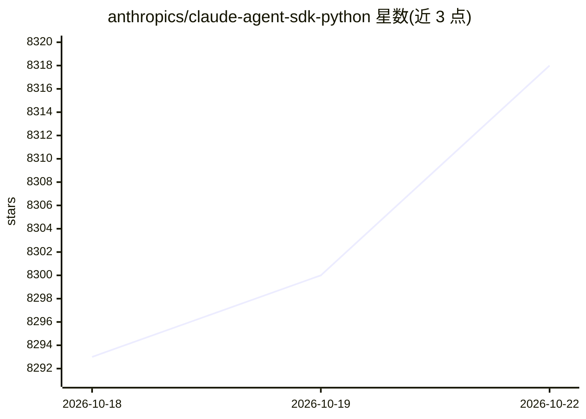

# anthropics/claude-agent-sdk-python

⭐ 8,332 · Python · MIT · 推送 2026-10-22 · [GitHub](https://github.com/anthropics/claude-agent-sdk-python) · 组织维护

**Anthropic 官方 Python SDK，用于构建和驱动 Claude Code agent**

Python SDK，封装 Claude Code CLI（随包捆绑分发，无需单独安装），供开发者在 Python 应用中查询与控制 Claude agent。提供 query() 异步迭代接口与 ClaudeSDKClient 双向交互客户端；支持 allowed_tools/disallowed_tools 权限控制、以进程内 SDK MCP Server 形式定义 Python 自定义工具（可与外部 MCP Server 混用）、在 agent 循环特定节点调用的 hooks、系统提示词配置与子代理/会话分叉。要求 Python 3.10+，经 pip 安装，受 Anthropic 商业服务条款约束。

## 筛选速览

| 维度 | 判定 | 备注 |
|---|---|---|
| AI 角色 | `ai-ecosystem` | LLM/agent 周边工具 |
| 许可风险 | `permissive` | MIT |
| 部署形态 | `library` | 以包/库形式分发 |
| 模型依赖 | locked-api |  |
| 硬件要求 | — | 无带数字的原话,不猜 |
| 安装摩擦 | `low` | 无编译、无系统依赖或容器化 |
| 成熟度 | — | 结构信号不足 |

## 能力要点

- query() 与 ClaudeSDKClient 两种调用接口，后者支持双向交互会话
- 自定义工具以进程内 SDK MCP Server 实现，无需子进程与 IPC
- Python 函数形式的 hooks，在 agent 循环节点做确定性处理
- Claude Code CLI 随 wheel 捆绑，开箱即用，也可指定自定义路径

## 适用场景

- 在 Python 应用中嵌入 Claude agent 完成读写文件、执行命令等任务
- 为 Claude 定义 Python 自定义工具并控制工具权限
- 用 hooks 拦截与审计 agent 的工具调用行为

## 场景标签

`Agent 框架` · 领域:Agent 开发

## 证据(README 行号)

> L3: Python SDK for Claude Agent. See the Claude Agent SDK documentation for more information.
> L31: `query()` is an async function for querying Claude Code. It returns an `AsyncIterator` of response messages. See sr

## 星数曲线

2026-10-18 8,293 → 2026-10-22 8,318（+25）

---
*卡片 v1 · prompt 1.4 · 生成 2026-10-20 · 置信度 high · 依据 README sha `5ad4c4ba6fee` · [字段定义](../../DATASET.md)*
