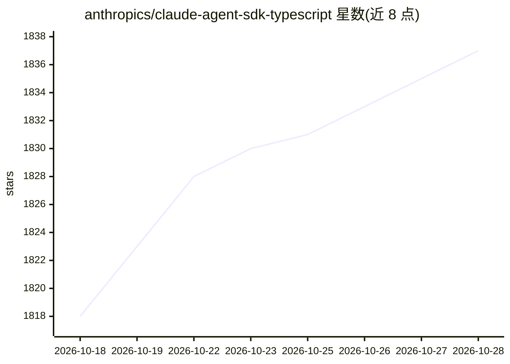

# anthropics/claude-agent-sdk-typescript

⭐ 1,841 · Shell · 推送 2026-10-27 · [GitHub](https://github.com/anthropics/claude-agent-sdk-typescript) · 组织维护

**Anthropic 官方 TypeScript SDK：编程构建具备 Claude Code 能力的 AI agent**

由 Anthropic 维护的 Claude Agent SDK（TypeScript 版），用于以编程方式构建 AI agent，使 agent 具备理解代码库、编辑文件、运行命令与执行复杂工作流的能力，这些能力来自 Claude Code。前身为 Claude Code SDK，README 指向迁移指南说明破坏性变更。以 npm 包 @anthropic-ai/claude-agent-sdk 分发，使用受 Anthropic 商业服务条款约束；同时说明其收集使用数据（如代码接受/拒绝、对话数据）及隐私保护措施。

## 筛选速览

| 维度 | 判定 | 备注 |
|---|---|---|
| AI 角色 | `ai-ecosystem` | LLM/agent 周边工具 |
| 许可风险 | `none` | — |
| 部署形态 | `library` | 以包/库形式分发 |
| 模型依赖 | locked-api |  |
| 硬件要求 | — | 无带数字的原话,不猜 |
| 安装摩擦 | `low` | 无编译、无系统依赖或容器化 |
| 成熟度 | — | 结构信号不足 |

## 能力要点

- 以编程方式构建具备 Claude Code 能力的自主 agent
- 支持理解代码库、编辑文件、运行命令与执行复杂工作流
- 由 Claude Code SDK 更名而来，提供迁移指南

## 适用场景

- 在自己的应用中构建能操作代码库的自动化 agent
- 编排执行复杂工作流的自主 agent
- 从 Claude Code SDK 迁移到新的 Agent SDK

## 场景标签

`Agent 框架` · 领域:Agent 开发

## 证据(README 行号)

> L5: The Claude Agent SDK enables you to programmatically build AI agents with Claude Code's capabilities. Create autonom
> L14: npm install @anthropic-ai/claude-agent-sdk

## 星数曲线

2026-10-18 1,818 → 2026-10-28 1,837（+19）

---
*卡片 v1 · prompt 1.4 · 生成 2026-10-21 · 置信度 high · 依据 README sha `80c7c632e905` · [字段定义](../../DATASET.md)*
