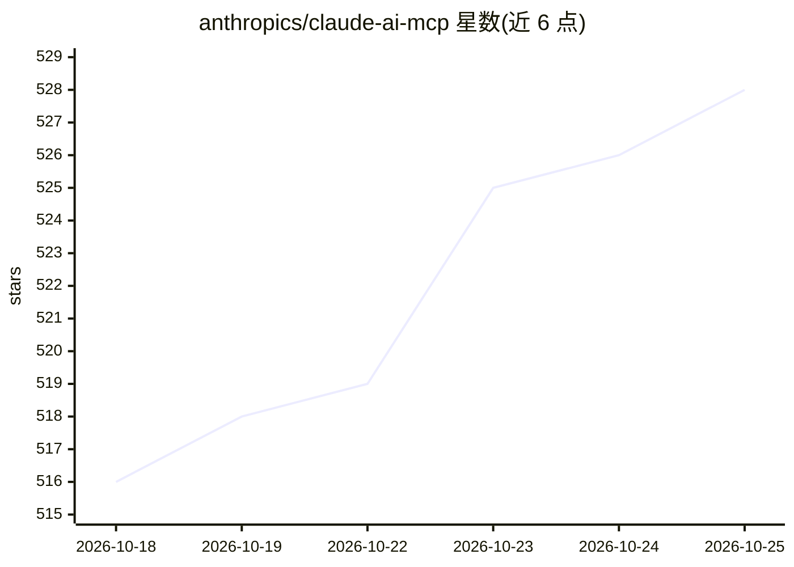

# anthropics/claude-ai-mcp

⭐ 529 · NOASSERTION · 推送 2026-06-08 · [GitHub](https://github.com/anthropics/claude-ai-mcp) · 组织维护

**Claude.ai MCP 集成的问题反馈与公告沟通中心**

Anthropic 维护的仓库，作为 Claude.ai 中 MCP（Model Context Protocol）集成的沟通枢纽：通过 Discussions 的 Announcements 分类发布协议变更（如 SSE 弃用、Streamable HTTP 更新）、会话行为变化、新能力与安全更新；通过 Issues 接收 MCP 服务器连接、会话管理、工具调用、OAuth 认证等范围的 bug 与功能请求。不覆盖 MCP 规范本身、MCP SDK 与非 MCP 的 Claude.ai 一般问题。仓库不含代码，使用受 Anthropic 商业服务条款约束。

## 筛选速览

| 维度 | 判定 | 备注 |
|---|---|---|
| AI 角色 | `ai-ecosystem` | LLM/agent 周边工具 |
| 许可风险 | `none` | NOASSERTION |
| 部署形态 | `None` |  |
| 模型依赖 | locked-api |  |
| 硬件要求 | — | 无带数字的原话,不猜 |
| 安装摩擦 | `low` | 无编译、无系统依赖或容器化 |
| 成熟度 | — | 结构信号不足 |

## 能力要点

- 公告渠道覆盖协议变更、破坏性变更与安全更新
- Issues 接收 MCP 集成相关的 bug 与功能请求
- 明确界定覆盖范围：集成、会话管理、协议支持、工具与认证

## 适用场景

- 跟踪 Claude.ai MCP 集成的协议与行为变更公告
- 上报 MCP 服务器连接或工具调用相关的 bug
- 请求 Claude.ai MCP 集成的新功能

## 场景标签

 · 领域:AI 生态/问题跟踪

## 证据(README 行号)

> L3: This repository is the communication hub for **MCP (Model Context Protocol) integration in Claude.ai**. Use it to st
> L26: - **Integrations** - Connecting MCP servers to Claude.ai

## 星数曲线

2026-10-18 516 → 2026-10-25 528（+12）

---
*卡片 v1 · prompt 1.4 · 生成 2026-10-21 · 置信度 high · 依据 README sha `74d44e42bcc7` · [字段定义](../../DATASET.md)*
