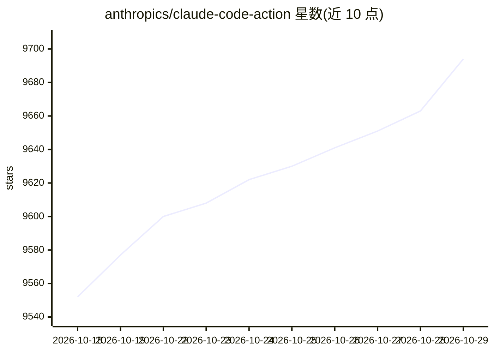

# anthropics/claude-code-action

⭐ 9,694 · TypeScript · MIT · 推送 2026-10-27 · [GitHub](https://github.com/anthropics/claude-code-action) · 组织维护

**在 GitHub PR/Issue 中调用 Claude Code 的通用 Action**

由 Anthropic 维护的 GitHub Action：在 PR 与 Issue 场景中调用 Claude Code 回答代码问题、审查 PR 变更并实现代码修改，支持通过 @claude 提及、Issue 指派或显式 prompt 触发，并能基于上下文自动选择执行模式。认证支持 Anthropic 直连 API（API key 或工作负载身份联合）、Amazon Bedrock、Google Vertex AI 与 Microsoft Foundry。Action 完全运行在用户自己的 GitHub runner 上，可通过 /install-github-app 命令快速安装，另附迁移指南与多种自动化方案示例。

## 筛选速览

| 维度 | 判定 | 备注 |
|---|---|---|
| AI 角色 | `ai-ecosystem` | LLM/agent 周边工具 |
| 许可风险 | `permissive` | MIT |
| 部署形态 | `None` |  |
| 模型依赖 | locked-api |  |
| 硬件要求 | — | 无带数字的原话,不猜 |
| 安装摩擦 | `low` | 无编译、无系统依赖或容器化 |
| 成熟度 | — | 结构信号不足 |

## 能力要点

- 根据工作流上下文自动选择执行模式（提及/指派/显式 prompt）
- 支持 Anthropic 直连 API、Bedrock、Vertex AI、Microsoft Foundry 多种认证方式
- 提供结构化 JSON 输出并转为 GitHub Action outputs
- 完全运行在用户自有 GitHub runner 上

## 适用场景

- 让 Claude 在 PR 评论中回答代码问题或实现修改
- 自动化的 PR 代码审查与检查清单执行
- Issue 自动分类打标与定时仓库维护任务

## 场景标签

`代码审查` `编码 Agent` · 领域:编码与开发

## 证据(README 行号)

> L5: A general-purpose Claude Code action for GitHub PRs and issues that can answer questions and implement code changes.
> L17: - 🏃 **Runs on Your Infrastructure**: The action executes entirely on your own GitHub runner (Anthropic API calls go

## 星数曲线

2026-10-18 9,552 → 2026-10-29 9,694（+142）

---
*卡片 v1 · prompt 1.4 · 生成 2026-10-20 · 置信度 high · 依据 README sha `f680b0481c76` · [字段定义](../../DATASET.md)*
