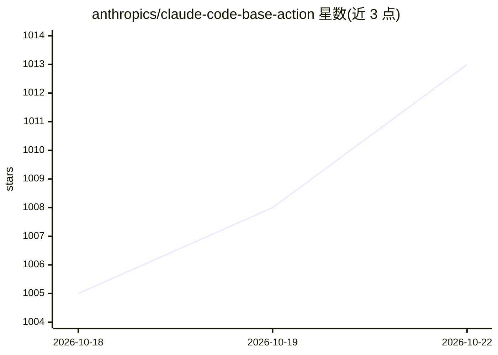

# anthropics/claude-code-base-action

⭐ 1,013 · TypeScript · MIT · 推送 2026-10-21 · [GitHub](https://github.com/anthropics/claude-code-base-action) · 组织维护

**在 GitHub Actions 中运行 Claude Code 的基础 Action**

anthropics/claude-code-action 仓库 base-action 目录的自动镜像，不接受 PR 与 issue。本体是一个 GitHub Action 薄封装：安装并运行 Claude Code CLI，调用方通过 prompt/prompt_file 输入指令，可传入 Claude Code 设置、MCP 配置与插件；输出执行状态、结构化 JSON、会话 ID。支持 Anthropic API key、OAuth token 与 Workload Identity Federation（OIDC 短期令牌）三种认证，可选 Amazon Bedrock / Google Vertex AI 后端。自身不设信任边界，处理不可信输入时应改用 claude-code-action。

## 筛选速览

| 维度 | 判定 | 备注 |
|---|---|---|
| AI 角色 | `ai-ecosystem` | LLM/agent 周边工具 |
| 许可风险 | `permissive` | MIT |
| 部署形态 | `None` |  |
| 模型依赖 | locked-api |  |
| 硬件要求 | — | 无带数字的原话,不猜 |
| 安装摩擦 | `low` | 无编译、无系统依赖或容器化 |
| 成熟度 | — | 结构信号不足 |

## 能力要点

- 在 GitHub Actions workflow 中安装并运行 Claude Code CLI
- Workload Identity Federation：用 GitHub OIDC 令牌换取短期访问令牌
- 支持 Claude Code settings、MCP 配置与插件安装的传入
- 输出 conclusion/structured_output/session_id，可用 --json-schema 获得类型化输出

## 适用场景

- 在 CI 中用 Claude Code 自动做 PR 代码审查
- 在 GitHub Actions 里构建基于 Claude Code 的自定义工作流
- 用短期 OIDC 令牌在 CI 中免静态密钥调用 Claude

## 场景标签

`编码 Agent` `代码审查` · 领域:编码与开发

## 证据(README 行号)

> L13: This GitHub Action allows you to run Claude Code within your GitHub Actions workflows. You can use this to build an
> L19: This action is a thin wrapper that installs and runs Claude Code with the inputs you provide. It does **not** enfor

## 星数曲线

2026-10-18 1,005 → 2026-10-22 1,013（+8）

---
*卡片 v1 · prompt 1.4 · 生成 2026-10-21 · 置信度 high · 依据 README sha `24b5f20ebfd9` · [字段定义](../../DATASET.md)*
