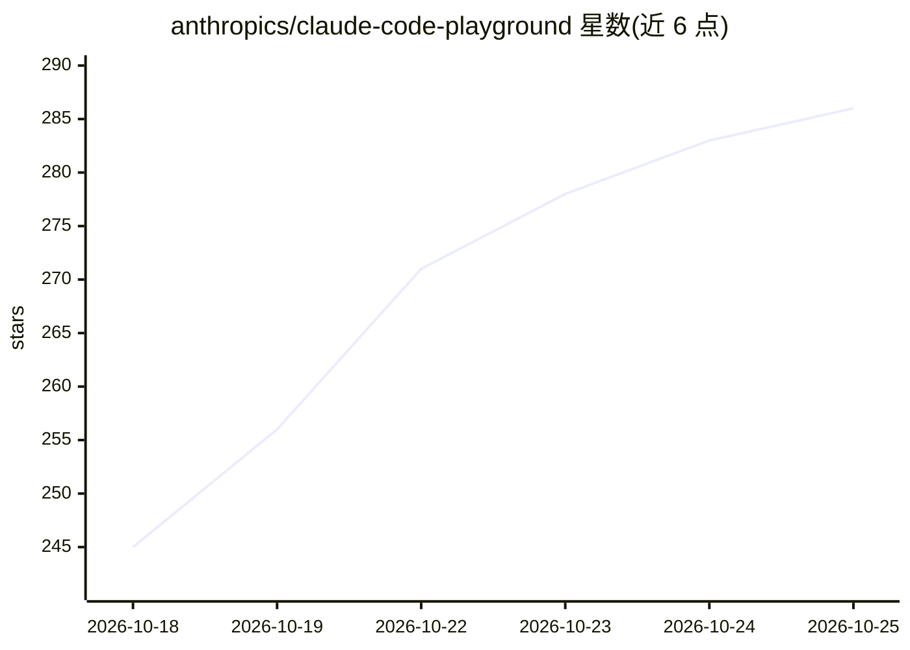

# anthropics/claude-code-playground

⭐ 292 · JavaScript · Apache-2.0 · 推送 2026-10-14 · [GitHub](https://github.com/anthropics/claude-code-playground) · 组织维护

**Anthropic DevRel 的 Claude Code 配置、技能与演示示例合集**

由 Anthropic DevRel 团队维护的示例聚合仓库，收录四类内容：团队实际使用的 Claude Code 配置（hooks、CLAUDE.md、settings.json、端到端工作流）、可复用技能、可能性演示（demos）与模型发布时的 launch demos（含确切 prompt 与搭建过程）。每个条目自包含，基于统一模板并附 Run it 说明与局限性描述，仓库根目录无需安装配置。声明非官方产品、按原样提供、暂不接受外部贡献；内容从私有源仓库人工导出发布。

## 筛选速览

| 维度 | 判定 | 备注 |
|---|---|---|
| AI 角色 | `ai-knowledge` | 知识聚合/清单类 |
| 许可风险 | `permissive` | Apache-2.0 |
| 部署形态 | `None` |  |
| 模型依赖 | locked-api |  |
| 硬件要求 | — | 无带数字的原话,不猜 |
| 安装摩擦 | `low` | 无编译、无系统依赖或容器化 |
| 成熟度 | — | 结构信号不足 |

## 能力要点

- 四类条目：配置示例、可复用技能、demos、launch demos
- 每个条目基于统一模板，说明所用模型、prompt、构建过程与局限
- 目录地图覆盖 hooks/CLAUDE.md/settings/workflows/mods/skills/demos 等 9 个目录
- 声明非官方产品，条目按原样提供且可能随产品变化失效

## 适用场景

- 查找 Claude Code 的 hooks、CLAUDE.md 与 settings.json 实际配置参考
- 了解 Claude Code 可实现的技能与工作流示例
- 按 launch demos 中的 prompt 与 setup 复现模型发布演示

## 场景标签

`精选清单` `教程课程` · 领域:学习与行业

## 证据(README 行号)

> L14: A collection of things the DevRel team is excited to share:
> L16: - **How we actually set up Claude Code** — real hooks, `CLAUDE.md` files, `settings.json` examples and end-to-end p

## 星数曲线

2026-10-18 245 → 2026-10-25 286（+41）

---
*卡片 v1 · prompt 1.4 · 生成 2026-10-22 · 置信度 high · 依据 README sha `28f886ca779e` · [字段定义](../../DATASET.md)*
