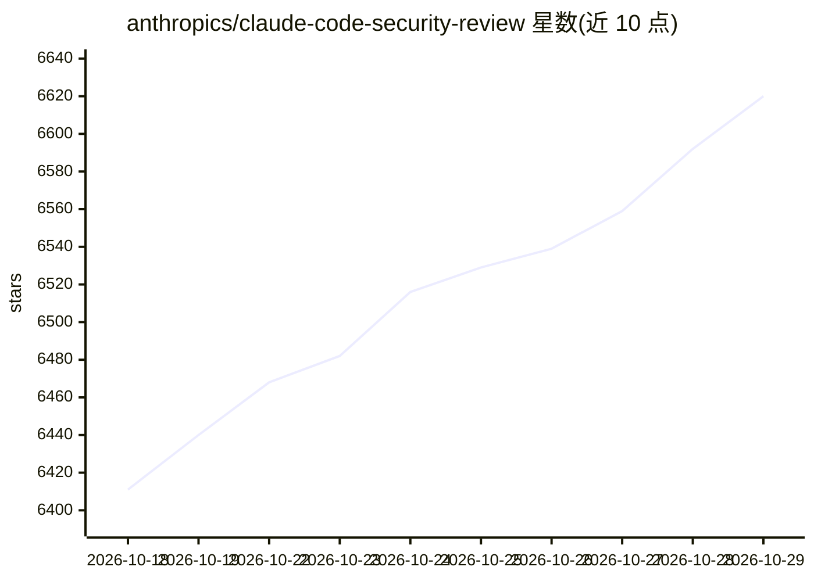

# anthropics/claude-code-security-review

⭐ 6,620 · Python · MIT · 推送 2026-02-11 · [GitHub](https://github.com/anthropics/claude-code-security-review) · 组织维护

**用 Claude 分析 PR 代码变更安全漏洞的 GitHub Action**

由 Anthropic 维护的 GitHub Action：在 PR 打开时调用 Claude Code 分析 diff，理解代码语义后生成含严重级别与修复建议的安全发现，自动以评审评论定位到具体代码行，并做误报过滤（排除 DoS、速率限制等低影响项）。需要 Anthropic API key（须同时启用 Claude API 与 Claude Code 权限），默认模型 Opus 4.1，支持自定义扫描指令与排除目录。README 声明该 Action 未对提示注入做加固，仅应用于可信 PR。另提供 Claude Code 内置 /security-review 命令。

## 筛选速览

| 维度 | 判定 | 备注 |
|---|---|---|
| AI 角色 | `ai-native` | 本体是模型或模型工具 |
| 许可风险 | `permissive` | MIT |
| 部署形态 | `None` |  |
| 模型依赖 | locked-api |  |
| 硬件要求 | — | 无带数字的原话,不猜 |
| 安装摩擦 | `low` | 无编译、无系统依赖或容器化 |
| 成熟度 | — | 结构信号不足 |

## 能力要点

- Diff 感知扫描：PR 场景只分析变更文件
- 检测注入、认证授权、加密、供应链等 10 类漏洞
- 可定制的误报过滤与自定义扫描指令
- Claude Code 内置 /security-review 斜杠命令提供同等分析

## 适用场景

- 在 CI 中对 PR 自动做安全审查并评论发现
- 为组织定制安全扫描与误报过滤规则
- 在 Claude Code 开发环境中用 /security-review 审查未提交变更

## 场景标签

`代码审查` · 领域:编码与开发

## 证据(README 行号)

> L1: # Claude Code Security Reviewer
> L65: 1. **PR Analysis**: When a pull request is opened, Claude analyzes the diff to understand what changed
> L67: 3. **Finding Generation**: Security issues are identified with detailed explanations, severity ratings, and remedia

## 星数曲线

2026-10-18 6,411 → 2026-10-29 6,620（+209）

---
*卡片 v1 · prompt 1.4 · 生成 2026-10-20 · 置信度 high · 依据 README sha `98a6947299dc` · [字段定义](../../DATASET.md)*
