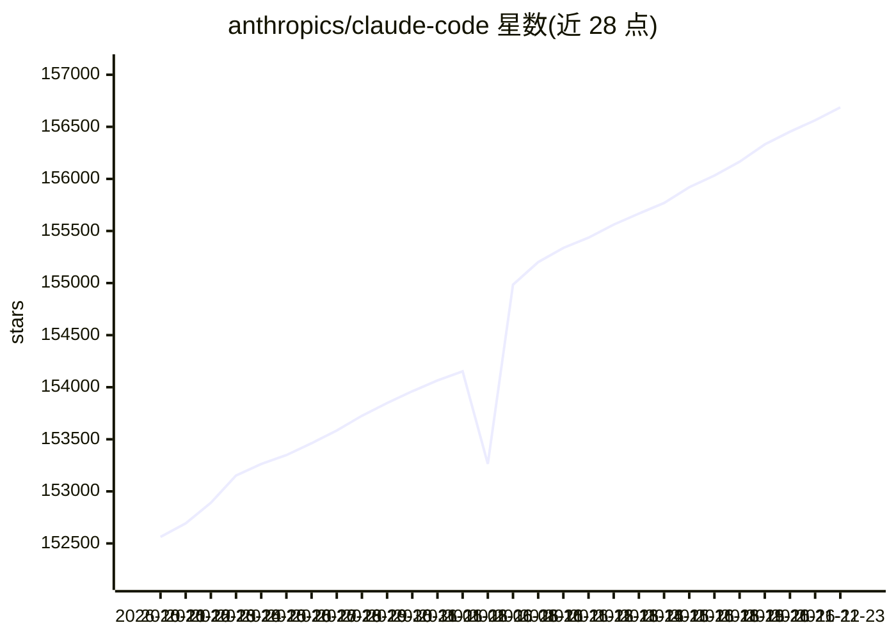

# anthropics/claude-code

⭐ 156,687 · TypeScript · 推送 2026-11-22 · [GitHub](https://github.com/anthropics/claude-code) · [官网](https://code.claude.com/docs/en/overview) · 组织维护

**终端里的 agentic 编码工具，用自然语言辅助编码与 git 工作流**

Anthropic 出品的 agentic 编码工具，运行在终端中，可在 IDE 使用或通过 GitHub 上的 @claude 标记调用。通过自然语言命令执行例行任务、解释复杂代码、处理 git 工作流。安装提供 macOS/Linux 与 Windows 的官方脚本、Homebrew、WinGet 等途径，npm 安装方式已被声明弃用。支持插件机制（官方插件仓库 claude-plugins-official），内置 /bug 命令反馈问题；README 说明会收集使用数据与对话数据，并声明了保留期限、访问限制等隐私保护措施。

## 筛选速览

| 维度 | 判定 | 备注 |
|---|---|---|
| AI 角色 | `ai-native` | 本体是模型或模型工具 |
| 许可风险 | `none` | — |
| 部署形态 | `library` | 以包/库形式分发 |
| 模型依赖 | locked-api |  |
| 硬件要求 | — | 无带数字的原话,不猜 |
| 安装摩擦 | `low` | 无编译、无系统依赖或容器化 |
| 成熟度 | — | 结构信号不足 |

## 动量与使用信号

- 维护:`active` — 距上次 push 1.4 天,年发版 100,57 位贡献者
- 涨星:近 1 天 **+363**(自 20261016 起算)
- 安装:npm 包 `@anthropic-ai/claude-code` 月下载 51,887,565
- 平台:WINDOWS / MACOS / LINUX · 协议:—

## 能力要点

- 在终端、IDE 或 GitHub（@claude）中使用，自然语言驱动
- 执行例行任务、解释复杂代码、处理 git 工作流
- 支持插件机制（claude-plugins-official 仓库）
- 内置 /bug 命令直接反馈问题

## 适用场景

- 在终端中用自然语言完成例行编码任务
- 让 AI 解释项目中的复杂代码
- 用自然语言处理 git 工作流
- 为 Claude Code 开发或安装插件

## 场景标签

`编码 Agent` · 领域:编码与开发

## 证据(README 行号)

> L5: Claude Code is an agentic coding tool that lives in your terminal, understands your codebase, and helps you code fas
> L15: 1. Install Claude Code:

## 星数曲线

2026-10-21 152,562 → 2026-11-23 156,687（+4,125）

---
*卡片 v1 · prompt 1.4 · 生成 2026-11-22 · 置信度 high · 依据 README sha `d253051738e0` · [字段定义](../../DATASET.md)*
