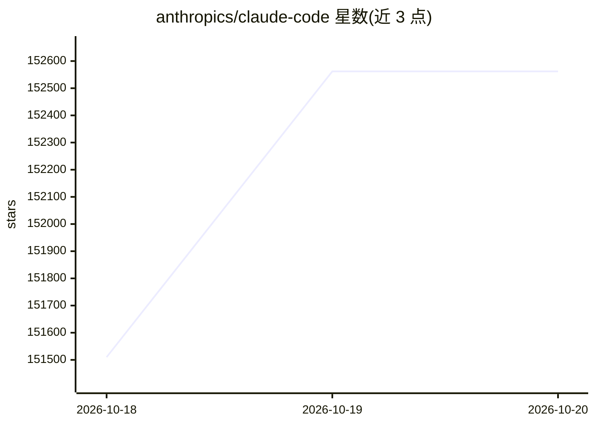

# anthropics/claude-code

⭐ 152,562 · TypeScript · 推送 2026-10-18 · [GitHub](https://github.com/anthropics/claude-code) · [官网](https://code.claude.com/docs/en/overview) · 组织维护

**终端里的 agentic 编码工具，用自然语言操作代码库**

Anthropic 出品的命令行编码代理：读取并理解代码库，通过自然语言执行例行任务、解释复杂代码、处理 git 工作流。可在终端、IDE 中使用，也可在 GitHub 上以 @claude 触发。仓库附带插件机制，以自定义命令和 agent 扩展功能。安装支持 macOS/Linux/Windows 的官方脚本、Homebrew 与 WinGet，npm 安装方式已被标注为弃用。使用数据（代码接受/拒绝、会话数据）会被收集用于反馈，官方声明有限保留期且不用于模型训练。

## 筛选速览

| 维度 | 判定 | 备注 |
|---|---|---|
| AI 角色 | `ai-native` | 本体是模型或模型工具 |
| 许可风险 | `none` | — |
| 部署形态 | `library` | 以包/库形式分发 |
| 模型依赖 | locked-api |  |
| 硬件要求 | — | 无带数字的原话,不猜 |
| 安装摩擦 | `low` | 无编译、无系统依赖或容器化 |
| 成熟度 | — | 结构信号不足 |

## 动量与使用信号

- 维护:`active` — 距上次 push 1.4 天,年发版 100,57 位贡献者
- 涨星:近 1 天 **+363**(自 20261016 起算)
- 安装:npm 包 `@anthropic-ai/claude-code` 月下载 51,887,565
- 平台:WINDOWS / MACOS / LINUX · 协议:—

## 能力要点

- 终端内自然语言驱动的 agentic 编码，理解代码库上下文
- 支持终端、IDE、GitHub @claude 多种使用入口
- 插件机制通过自定义命令和 agent 扩展功能
- 内置 /bug 命令直接上报问题

## 适用场景

- 在终端用自然语言完成例行编码任务
- 让 AI 解释复杂代码逻辑
- 用自然语言处理 git 工作流
- 通过插件为工作流添加自定义命令和 agent

## 场景标签

`编码 Agent` · 领域:编码与开发

## 证据(README 行号)

> L5: Claude Code is an agentic coding tool that lives in your terminal, understands your codebase, and helps you code fas
> L46: This repository includes several Claude Code plugins that extend functionality with custom commands and agents. See

## 星数曲线

2026-10-18 151,510 → 2026-10-20 152,562（+1,052）

---
*卡片 v1 · prompt 1.4 · 生成 2026-10-18 · 置信度 mid · 依据 README sha `1788fe37f265` · [字段定义](../../DATASET.md)*
