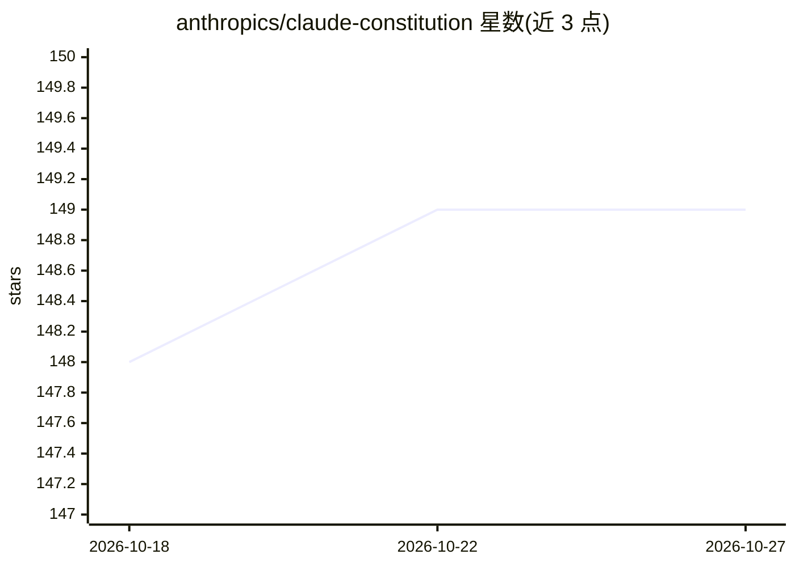

# anthropics/claude-constitution

⭐ 149 · CC0-1.0 · 推送 2026-01-29 · [GitHub](https://github.com/anthropics/claude-constitution) · 组织维护

**Anthropic 发布的 Claude 价值观与行为准则文档**

存储 Claude Constitution 的文档仓库：该文档描述期望 Claude 体现的价值观及其背后的推理，涵盖在保持安全与伦理的前提下提供帮助的方式，并为权衡难题提供指引。发布目的是对 Claude 的指导方式提供透明度；当前版本为 2026 年 1 月，后续将随宪法演进更新仓库并归档旧版本。仓库另链接博客文章与在线阅读地址，采用 CC0 1.0 许可发布。

## 筛选速览

| 维度 | 判定 | 备注 |
|---|---|---|
| AI 角色 | `ai-knowledge` | 知识聚合/清单类 |
| 许可风险 | `viral` | CC0-1.0 |
| 部署形态 | `None` |  |
| 模型依赖 | — | README 未给出锁定关系 |
| 硬件要求 | — | 无带数字的原话,不猜 |
| 安装摩擦 | `low` | 无编译、无系统依赖或容器化 |
| 成熟度 | — | 结构信号不足 |

## 能力要点

- 描述 Claude 价值观与决策权衡的指导文档
- 发布以提供 Claude 发展指导的透明度
- 旧版本将随更新归档于本仓库

## 适用场景

- 查阅 Claude 的价值观与行为准则原文
- 了解 Claude 宪法随时间的版本演进

## 场景标签

 · 领域:AI 治理/文档

## 证据(README 行号)

> L3: This repository contains Claude's Constitution—the foundational document that describes the values we want Claude to
> L5: We're releasing it to provide transparency into how we guide Claude's development. The current version is from Janua

## 星数曲线

2026-10-18 148 → 2026-10-27 149（+1）

---
*卡片 v1 · prompt 1.4 · 生成 2026-10-22 · 置信度 high · 依据 README sha `85d3e2161ea7` · [字段定义](../../DATASET.md)*
