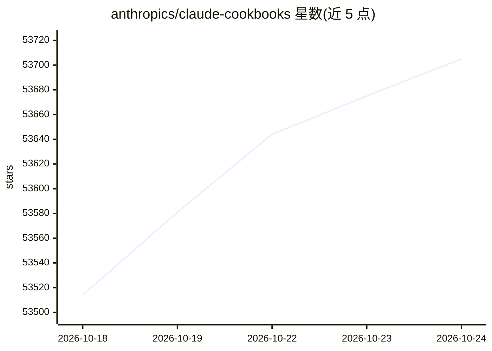

# anthropics/claude-cookbooks

⭐ 53,705 · Jupyter Notebook · MIT · 推送 2026-10-17 · [GitHub](https://github.com/anthropics/claude-cookbooks) · 组织维护

**面向开发者的 Claude 使用示例与指南手册**

以 notebook/recipe 形式提供可复制的代码片段与指南，覆盖分类、RAG、摘要、工具调用、第三方集成、多模态、提示缓存、成本优化、JSON 输出、内容审核等主题。使用示例需要 Claude API key，代码以 Python 为主但说明可适配其他支持 Claude API 的语言。内容组织为 Capabilities、Tool Use、Third-Party Integrations、Multimodal、Advanced Techniques 等章节。

## 筛选速览

| 维度 | 判定 | 备注 |
|---|---|---|
| AI 角色 | `ai-ecosystem` | LLM/agent 周边工具 |
| 许可风险 | `permissive` | MIT |
| 部署形态 | `None` |  |
| 模型依赖 | locked-api |  |
| 硬件要求 | — | 无带数字的原话,不猜 |
| 安装摩擦 | `low` | 无编译、无系统依赖或容器化 |
| 成熟度 | — | 结构信号不足 |

## 动量与使用信号

- 维护:`active` — 距上次 push 1.3 天,年发版 0,87 位贡献者
- 涨星:近 1 天 **+33**(自 20261016 起算)
- 安装:github 包 `release-assets` 月下载无数据

## 能力要点

- 提供分类、RAG、摘要、工具调用等能力的示例 notebook
- 包含 Pinecone、Wikipedia、Voyage AI 等第三方集成示例
- 涵盖子 agent、提示缓存、成本优化、自动评估等进阶技术
- 提供 Claude API Fundamentals 课程作为入门路径

## 适用场景

- 为项目集成 Claude API 时复制现成代码片段
- 学习 RAG、视觉、工具调用等能力的实现方式
- 通过成本优化清单寻找 agent 的成本/效果配置

## 场景标签

`教程课程` `提示工程` · 领域:Agent 开发

## 证据(README 行号)

> L1: # Claude Cookbooks
> L3: The Claude Cookbooks provide code and guides designed to help developers build with Claude, offering copy-able code 
> L7: To make the most of the examples in this cookbook, you'll need a Claude API key (sign up for free here).

## 星数曲线

2026-10-18 53,514 → 2026-10-24 53,705（+191）

---
*卡片 v1 · prompt 1.4 · 生成 2026-10-18 · 置信度 high · 依据 README sha `00e0abaa7983` · [字段定义](../../DATASET.md)*
