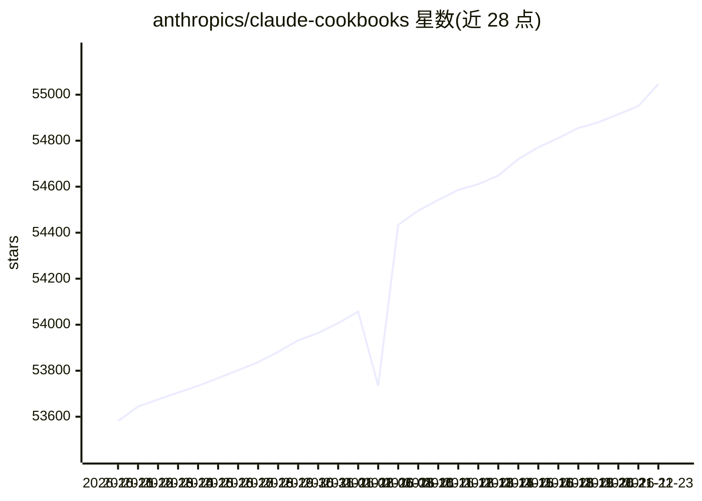

# anthropics/claude-cookbooks

⭐ 55,046 · Jupyter Notebook · MIT · 推送 2026-11-20 · [GitHub](https://github.com/anthropics/claude-cookbooks) · 组织维护

**面向开发者的 Claude 使用示例与教程合集**

Anthropic 维护的 Claude cookbook 仓库，以 notebook/recipe 形式提供可复制的代码片段与指南，覆盖分类、RAG、摘要、工具调用、多模态视觉、PDF 解析、JSON 模式、提示缓存、成本与延迟优化等主题，并含 Pinecone、Voyage AI、Stable Diffusion 等第三方集成示例。代码以 Python 为主，需 Claude API key 运行，概念可迁移到其他语言。属于教程资源集合，非可安装软件。

## 筛选速览

| 维度 | 判定 | 备注 |
|---|---|---|
| AI 角色 | `ai-knowledge` | 知识聚合/清单类 |
| 许可风险 | `permissive` | MIT |
| 部署形态 | `None` |  |
| 模型依赖 | locked-api |  |
| 硬件要求 | — | 无带数字的原话,不猜 |
| 安装摩擦 | `low` | 无编译、无系统依赖或容器化 |
| 成熟度 | — | 结构信号不足 |

## 动量与使用信号

- 维护:`active` — 距上次 push 1.3 天,年发版 0,87 位贡献者
- 涨星:近 1 天 **+33**(自 20261016 起算)
- 安装:github 包 `release-assets` 月下载无数据

## 能力要点

- 提供分类、RAG、摘要等能力的可复制代码示例
- 覆盖工具调用、子代理、自动评估等进阶技术
- 含成本与延迟优化的实操流程
- 多模态示例：视觉、图表解读、表单抽取、Stable Diffusion 出图

## 适用场景

- 为项目接入 Claude API 时查找参考实现
- 学习提示工程与提示缓存等进阶用法
- 参考 RAG 与向量数据库集成方案
- 对 agent 做成本与延迟调优时借鉴方法

## 场景标签

`教程课程` · 领域:学习与行业

## 证据(README 行号)

> L3: The Claude Cookbooks provide code and guides designed to help developers build with Claude, offering copy-able code 
> L25: ### Capabilities
> L50: ### Advanced Techniques

## 星数曲线

2026-10-21 53,581 → 2026-11-23 55,046（+1,465）

---
*卡片 v1 · prompt 1.4 · 生成 2026-11-22 · 置信度 high · 依据 README sha `17a90ceaf04c` · [字段定义](../../DATASET.md)*
