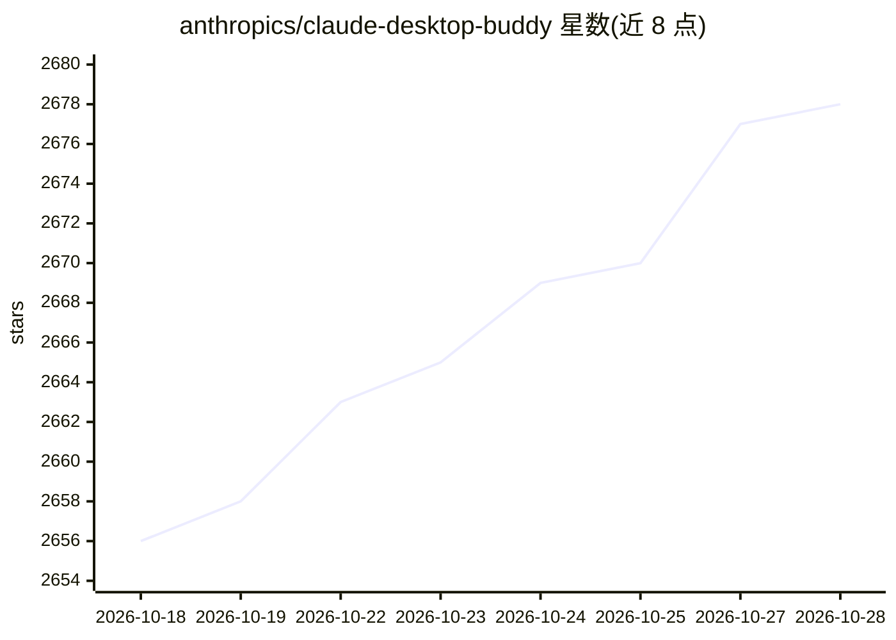

# anthropics/claude-desktop-buddy

⭐ 2,681 · C++ · NOASSERTION · 推送 2026-04-16 · [GitHub](https://github.com/anthropics/claude-desktop-buddy) · 组织维护

**Claude 桌面端 BLE API 参考实现：ESP32 桌宠硬件示例**

Anthropic 官方仓库，提供 Claude for macOS/Windows 连接外设的蓝牙（BLE）轻量 API 参考与示例：通过 Nordic UART 服务与文件夹推送传输，向 maker 设备发送权限提示、最近消息等交互数据。示例固件为运行在 M5StickC Plus（ESP32/Arduino 框架）上的桌宠，可显示 Claude 会话状态并在设备端批准/拒绝权限请求，支持 18 个 ASCII 宠物与自定义 GIF 形象包。需在桌面端开启开发者模式配对使用，API 为面向 maker 的非官方支持功能。

## 筛选速览

| 维度 | 判定 | 备注 |
|---|---|---|
| AI 角色 | `ai-ecosystem` | LLM/agent 周边工具 |
| 许可风险 | `none` | NOASSERTION |
| 部署形态 | `None` |  |
| 模型依赖 | — | README 未给出锁定关系 |
| 硬件要求 | — | 无带数字的原话,不猜 |
| 安装摩擦 | `low` | 无编译、无系统依赖或容器化 |
| 成熟度 | `idea` | |

## 能力要点

- REFERENCE.md 定义 Nordic UART UUID、JSON schema 与 folder push 传输协议
- ESP32/M5StickC Plus 桌宠固件：7 种状态、设备端权限批准/拒绝
- 自定义 GIF 形象包经 BLE 推送，附 tools/prep_character.py 处理工具
- PlatformIO 刷写与设备端恢复出厂设置流程

## 适用场景

- 为 Claude Cowork/Claude Code Desktop 构建外接硬件设备
- 在实体桌宠上显示 Claude 会话状态并远程批准权限
- 参考 wire protocol 自研不依赖本仓库代码的设备

## 场景标签

 · 领域:开发者工具/硬件集成

## 证据(README 行号)

> L3: Claude for macOS and Windows can connect Claude Cowork and Claude Code to
> L4: maker devices over BLE, so developers and makers can build hardware that
> L144: The BLE API is only available when the desktop apps are in developer mode

## 星数曲线

2026-10-18 2,656 → 2026-10-28 2,678（+22）

---
*卡片 v1 · prompt 1.4 · 生成 2026-10-21 · 置信度 high · 依据 README sha `9ae1a9db4652` · [字段定义](../../DATASET.md)*
