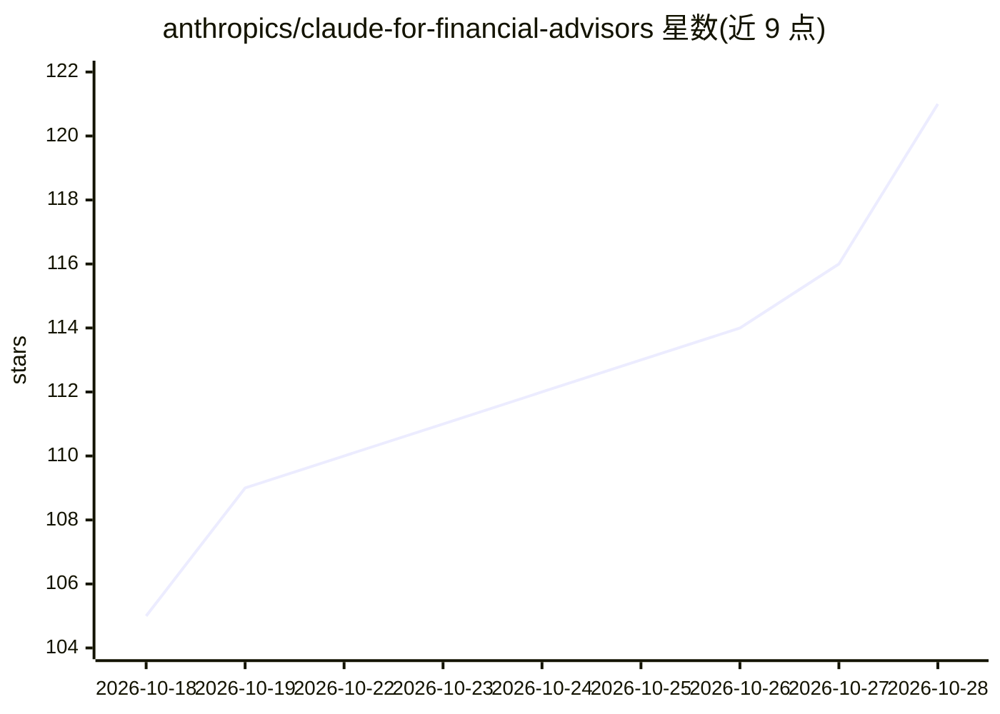

# anthropics/claude-for-financial-advisors

⭐ 121 · HTML · Apache-2.0 · 推送 2026-10-27 · [GitHub](https://github.com/anthropics/claude-for-financial-advisors) · 组织维护

**面向财务顾问的 Claude Cowork 插件：8 个即用工作流**

Anthropic 发布的 Claude Cowork 插件，以 Markdown/JSON 指令形式提供 8 个面向财务顾问的技能：客户入驻引导、会前准备文档、会后 CRM 笔记、SEC 合规预检、潜在客户资料整理、再平衡审查、另类投资简报与遗产税务简报。数据通过第三方连接器（Addepar、BlackRock、Wealthbox 等）实时拉取，插件本身不存储客户数据；任何写回外部系统的操作均需顾问显式批准。定位为参考实现，不积极维护、不接受贡献，输出不构成投资建议。

## 筛选速览

| 维度 | 判定 | 备注 |
|---|---|---|
| AI 角色 | `ai-native` | 本体是模型或模型工具 |
| 许可风险 | `permissive` | Apache-2.0 |
| 部署形态 | `None` |  |
| 模型依赖 | locked-api |  |
| 硬件要求 | — | 无带数字的原话,不猜 |
| 安装摩擦 | `low` | 无编译、无系统依赖或容器化 |
| 成熟度 | — | 结构信号不足 |

## 能力要点

- 8 个技能覆盖入驻、会前会后、合规预检、再平衡等顾问工作流
- 通过 12+ 第三方连接器拉取投资组合、CRM、财务规划数据
- 未连接的系统回退到粘贴/上传方式，写操作需顾问批准
- 子代理受只读工具白名单与拒绝 shell/写文件限制的安全结构

## 适用场景

- 会前自动生成客户回顾准备文档
- 把会议记录或转录转为 CRM 笔记
- 对客户材料按 SEC 营销规则等做合规预检并给出修订稿

## 场景标签

`工作流自动化` `金融量化` · 领域:效率与自动化

## 证据(README 行号)

> L3: A plugin from Anthropic that gives financial advisors a set of ready-to-run workflows for Claude Cowork that draw li
> L5: The plugin is a set of skills written as plain instructions (Markdown and JSON). It holds no client data: when an ad

## 星数曲线

2026-10-18 105 → 2026-10-28 121（+16）

---
*卡片 v1 · prompt 1.4 · 生成 2026-10-23 · 置信度 high · 依据 README sha `18af657b0871` · [字段定义](../../DATASET.md)*
