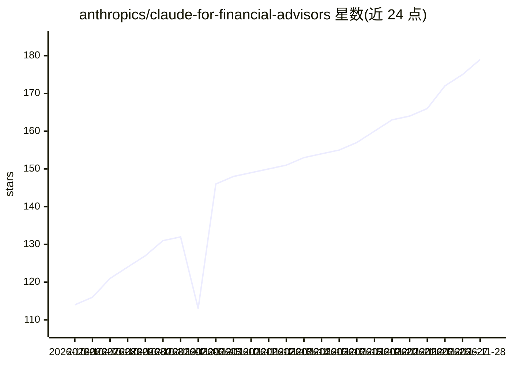

# anthropics/claude-for-financial-advisors

⭐ 179 · HTML · Apache-2.0 · 推送 2026-11-26 · [GitHub](https://github.com/anthropics/claude-for-financial-advisors) · 组织维护

**面向理财顾问的 Claude Cowork 工作流插件**

Anthropic 发布的 Claude Cowork 插件，为理财顾问提供 8 个即用型技能：客户会前准备、会后 CRM 记录、SEC 营销规则合规预检、潜在客户资料整理、组合再平衡审查、另类投资简报、遗产税务简报与首次设置引导。技能以 Markdown/JSON 指令编写，通过第三方连接器拉取公司现有系统的实时数据，未连接时回退为粘贴/上传；所有写回外部系统的操作需顾问逐一批准。不存储客户数据，输出需人工复核，非投资建议。

## 筛选速览

| 维度 | 判定 | 备注 |
|---|---|---|
| AI 角色 | `ai-native` | 本体是模型或模型工具 |
| 许可风险 | `permissive` | Apache-2.0 |
| 部署形态 | `None` |  |
| 模型依赖 | locked-api |  |
| 硬件要求 | — | 无带数字的原话,不猜 |
| 安装摩擦 | `low` | 无编译、无系统依赖或容器化 |
| 成熟度 | — | 结构信号不足 |

## 能力要点

- 8 个即用技能覆盖会前/会后/合规/再平衡等顾问流程
- 通过 21 个第三方连接器拉取 CRM、托管与组合数据
- 所有写回外部系统的操作需顾问明确批准
- 以 Apache 2.0 许可发布，声明为参考实现

## 适用场景

- 客户会前自动生成快照、组合回顾与会谈议程
- 将会议记录转为 CRM 笔记
- 对外材料按 SEC 营销规则做合规预检

## 场景标签

`工作流自动化` `知识库管理` · 领域:效率与自动化

## 证据(README 行号)

> L3: A plugin from Anthropic that gives financial advisors a set of ready-to-run workflows for Claude Cowork that draw li
> L5: The plugin is a set of skills written as plain instructions (Markdown and JSON). It holds no client data: when an ad

## 星数曲线

2026-10-26 114 → 2026-11-28 179（+65）

---
*卡片 v1 · prompt 1.4 · 生成 2026-11-26 · 置信度 high · 依据 README sha `3081dfe0391a` · [字段定义](../../DATASET.md)*
