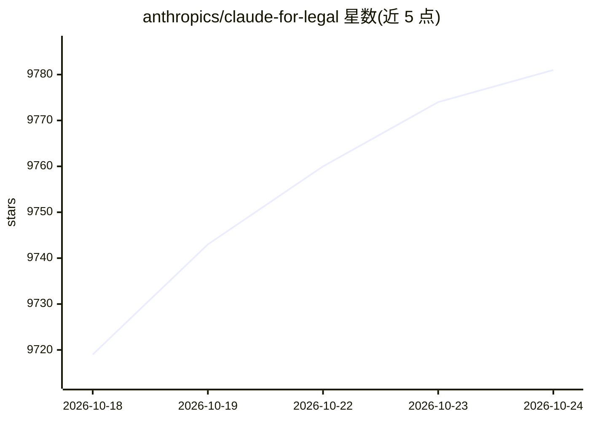

# anthropics/claude-for-legal

⭐ 9,786 · Python · Apache-2.0 · 推送 2026-10-23 · [GitHub](https://github.com/anthropics/claude-for-legal) · 组织维护

**面向法律工作流的 Claude 插件套件：agents、技能与连接器**

Anthropic 维护的法律工作流插件套件，覆盖商事、隐私、产品、公司、雇佣、诉讼、监管、AI 治理、IP 及法学院教学场景。内容含按执业领域划分的插件（每个以冷启动访谈学习团队 playbook）、托管 agent cookbook、面向 Slack/Ironclad/iManage 等系统的 MCP 连接器，以及 60 余个具名 agent（如供应商协议审阅、DSAR 响应、权利要求对照表生成）。可通过 Claude Cowork/Claude Code 插件或 Claude Managed Agents API 两种方式部署。所有输出定位为供律师复核的草稿，内置引用溯源、特权保守默认与发送前门控等护栏。

## 筛选速览

| 维度 | 判定 | 备注 |
|---|---|---|
| AI 角色 | `ai-native` | 本体是模型或模型工具 |
| 许可风险 | `permissive` | Apache-2.0 |
| 部署形态 | `None` |  |
| 模型依赖 | locked-api |  |
| 硬件要求 | — | 无带数字的原话,不猜 |
| 安装摩擦 | `low` | 无编译、无系统依赖或容器化 |
| 成熟度 | — | 结构信号不足 |

## 能力要点

- 覆盖 9 个执业领域的 60 余个具名 agent，单个命令即可运行
- 同一来源两种部署：Claude Cowork/Claude Code 插件或 Managed Agents API
- 冷启动访谈学习团队 playbook，技能读取 CLAUDE.md 实务画像
- MCP 连接器覆盖 Slack/Google Drive 与 Ironclad/DocuSign/iManage/Everlaw 等法律系统

## 适用场景

- 用 vendor 审阅与 NDA 分诊 agent 处理商事合同流程
- 在法定时限内起草 DSAR 回复与隐私影响评估
- 监控法院 docket、监管动态与合同续约截止日期
- 生成权利要求对照表与取证准备提纲供律师复核

## 场景标签

 · 领域:法律/合规

## 证据(README 行号)

> L3: Reference agents, skills, and data connectors for the legal workflows we see most — in-house commercial, privacy, pr
> L7: Everything here is available **two ways from one source**: install it as a Claude Cowork or Claude Code plugin, or d

## 星数曲线

2026-10-18 9,719 → 2026-10-24 9,781（+62）

---
*卡片 v1 · prompt 1.4 · 生成 2026-10-20 · 置信度 high · 依据 README sha `dd21fc77e637` · [字段定义](../../DATASET.md)*
