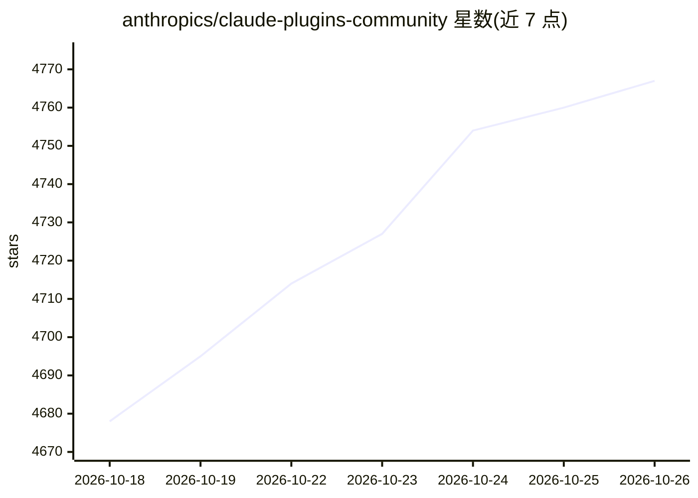

# anthropics/claude-plugins-community

⭐ 4,767 · JavaScript · Apache-2.0 · 推送 2026-10-25 · [GitHub](https://github.com/anthropics/claude-plugins-community) · 组织维护

**Claude Cowork 与 Claude Code 的社区插件市场镜像清单**

Anthropic 组织下的社区插件市场只读镜像：以 .claude-plugin/marketplace.json 文件形式提供可安装的社区插件列表，每夜从内部审核流水线同步。所有条目均经 claude.ai 提交、通过自动化安全扫描并获分发批准。用户可在 claude.com/plugins（Cowork）安装，或通过 Claude Code 命令行添加该市场并安装插件；插件提交走 clau.de 链接，仓库不接受直接 PR。

## 筛选速览

| 维度 | 判定 | 备注 |
|---|---|---|
| AI 角色 | `ai-knowledge` | 知识聚合/清单类 |
| 许可风险 | `permissive` | Apache-2.0 |
| 部署形态 | `None` |  |
| 模型依赖 | — | README 未给出锁定关系 |
| 硬件要求 | — | 无带数字的原话,不猜 |
| 安装摩擦 | `low` | 无编译、无系统依赖或容器化 |
| 成熟度 | — | 结构信号不足 |

## 能力要点

- marketplace.json 插件列表每夜从内部审核流水线同步
- 条目均通过自动化安全扫描并经批准分发
- 支持 Claude Code 命令行添加市场并安装插件
- 直接对仓库提 PR 会被自动关闭，变更仅来自内部流水线

## 适用场景

- 为 Claude Code 添加社区插件市场并安装插件
- 在 claude.com/plugins 浏览 Cowork 可用社区插件
- 通过提交链接将自有插件纳入社区市场

## 场景标签

`精选清单` · 领域:学习与行业

## 证据(README 行号)

> L7: A **read-only mirror** of the community plugin marketplace. The `.claude-plugin/marketplace.json` file here is the l
> L20: claude plugin marketplace add anthropics/claude-plugins-community

## 星数曲线

2026-10-18 4,678 → 2026-10-26 4,767（+89）

---
*卡片 v1 · prompt 1.4 · 生成 2026-10-20 · 置信度 high · 依据 README sha `6b7979d48509` · [字段定义](../../DATASET.md)*
