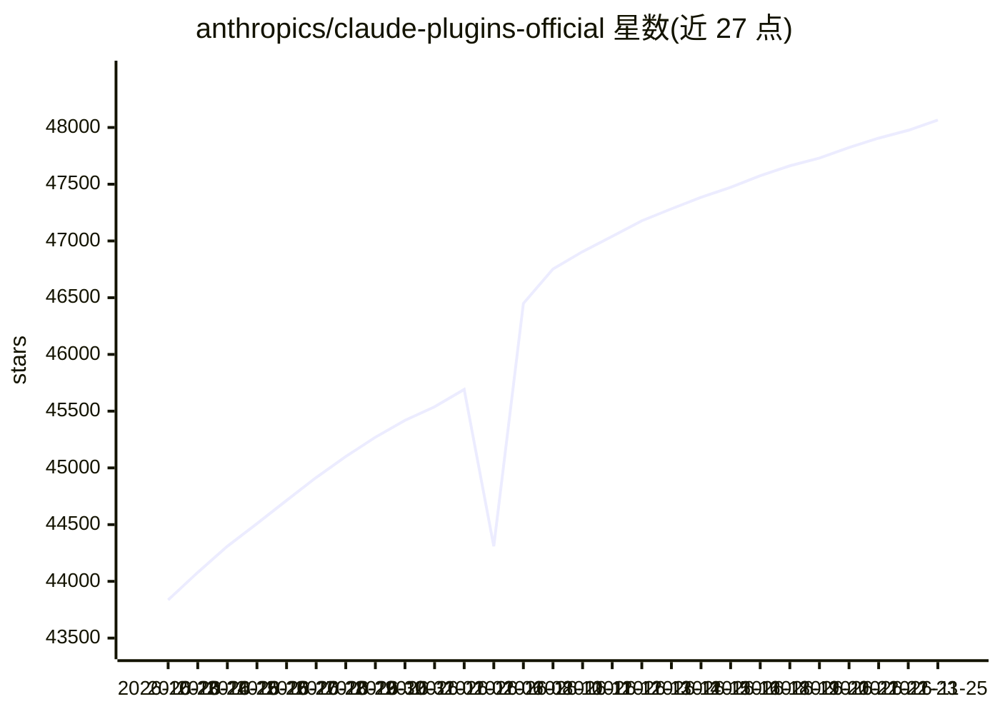

# anthropics/claude-plugins-official

⭐ 48,066 · Python · Apache-2.0 · 推送 2026-11-24 · [GitHub](https://github.com/anthropics/claude-plugins-official) · [官网](https://code.claude.com/docs/en/plugins) · 组织维护

**Anthropic 官方维护的 Claude Code 插件市场仓库**

Anthropic 管理的 Claude Code 插件目录与 marketplace：/plugins 收录 Anthropic 自研插件，/external_plugins 保留提交入口迁移前的第三方插件及频道插件（Discord、Telegram 等）。插件通过 Claude Code 的 /plugin install 命令或 Discover 浏览安装。README 规定第三方插件须在 claude.ai/directory/manage 提交，本仓库 PR 不被受理；并说明插件命名不可变、renames 迁移映射与 skill-bundle（无 manifest 的 SKILL.md 打包）机制。

## 筛选速览

| 维度 | 判定 | 备注 |
|---|---|---|
| AI 角色 | `ai-ecosystem` | LLM/agent 周边工具 |
| 许可风险 | `permissive` | Apache-2.0 |
| 部署形态 | `None` |  |
| 模型依赖 | — | README 未给出锁定关系 |
| 硬件要求 | — | 无带数字的原话,不猜 |
| 安装摩擦 | `low` | 无编译、无系统依赖或容器化 |
| 成熟度 | — | 结构信号不足 |

## 动量与使用信号

- 维护:`active` — 距上次 push 0.6 天,年发版 0,42 位贡献者
- 涨星:近 1 天 **+1,794**(自 20261016 起算)
- 安装:github 包 `release-assets` 月下载无数据
- 平台:— · 协议:MCP

## 能力要点

- 通过 Claude Code 插件系统直接安装：/plugin install {plugin-name}@claude-plugins-official
- 插件 name 为不可变 slug，renames 映射支持自动迁移
- 支持 skill-bundle 插件：直接声明 SKILL.md 路径数组
- 每个插件目录在 PR 时由仓库检查覆盖

## 适用场景

- 为 Claude Code 查找并安装 Anthropic 官方插件
- 开发插件时参照 /plugins/example-plugin 参考实现
- 了解插件 marketplace.json 结构与命名规则

## 场景标签

`精选清单` · 领域:学习与行业

## 证据(README 行号)

> L3: Anthropic's own plugins for Claude, and the `claude-plugins-official` marketplace for Claude Code.
> L22: Plugins can be installed directly from this marketplace via Claude Code's plugin system.

## 星数曲线

2026-10-23 43,836 → 2026-11-25 48,066（+4,230）

---
*卡片 v1 · prompt 1.4 · 生成 2026-11-22 · 置信度 mid · 依据 README sha `5cdbc7413e4a` · [字段定义](../../DATASET.md)*
