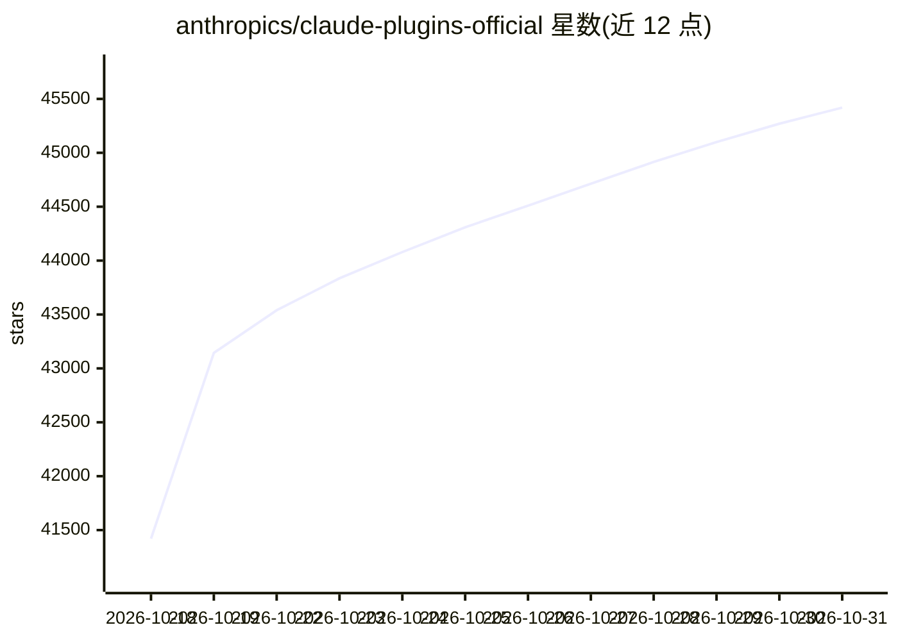

# anthropics/claude-plugins-official

⭐ 45,419 · Python · Apache-2.0 · 推送 2026-10-30 · [GitHub](https://github.com/anthropics/claude-plugins-official) · [官网](https://code.claude.com/docs/en/plugins) · 组织维护

**Anthropic 官方维护的 Claude Code 插件市场目录**

由 Anthropic 管理的 Claude Code 插件官方目录，分内部插件（/plugins，Anthropic 团队开发）与外部插件（/external_plugins，第三方伙伴与社区提交，需通过质量与安全审核）。插件通过 Claude Code 内置插件系统安装（/plugin install 命令或 Discover 界面浏览）。README 还规定了插件目录结构（plugin.json 清单）、插件名 slug 不可变更及 renames 迁移机制、以及无清单仓库以 skills 数组打包技能的方式。

## 筛选速览

| 维度 | 判定 | 备注 |
|---|---|---|
| AI 角色 | `ai-ecosystem` | LLM/agent 周边工具 |
| 许可风险 | `permissive` | Apache-2.0 |
| 部署形态 | `None` |  |
| 模型依赖 | locked-api |  |
| 硬件要求 | — | 无带数字的原话,不猜 |
| 安装摩擦 | `low` | 无编译、无系统依赖或容器化 |
| 成熟度 | — | 结构信号不足 |

## 动量与使用信号

- 维护:`active` — 距上次 push 0.6 天,年发版 0,42 位贡献者
- 涨星:近 1 天 **+1,794**(自 20261016 起算)
- 安装:github 包 `release-assets` 月下载无数据
- 平台:— · 协议:MCP

## 能力要点

- 官方市场，插件可经 /plugin install {name}@claude-plugins-official 安装
- 内部插件由 Anthropic 开发，外部插件需质量与安全审核
- 插件名 slug 不可变，renames 映射支持重命名自动迁移
- 支持 skill-bundle 形式：无清单仓库可直接声明 SKILL.md 技能路径

## 适用场景

- 在 Claude Code 中发现并安装官方与社区插件
- 第三方开发者按规范向官方市场提交插件
- 插件作者为存量用户提供 slug 重命名的平滑迁移

## 场景标签

`精选清单` · 领域:学习与行业

## 证据(README 行号)

> L3: A curated directory of high-quality plugins for Claude Code.
> L9: - **`/plugins`** - Internal plugins developed and maintained by Anthropic
> L10: - **`/external_plugins`** - Third-party plugins from partners and the community

## 星数曲线

2026-10-18 41,420 → 2026-10-31 45,419（+3,999）

---
*卡片 v1 · prompt 1.4 · 生成 2026-10-18 · 置信度 high · 依据 README sha `365816217d2b` · [字段定义](../../DATASET.md)*
