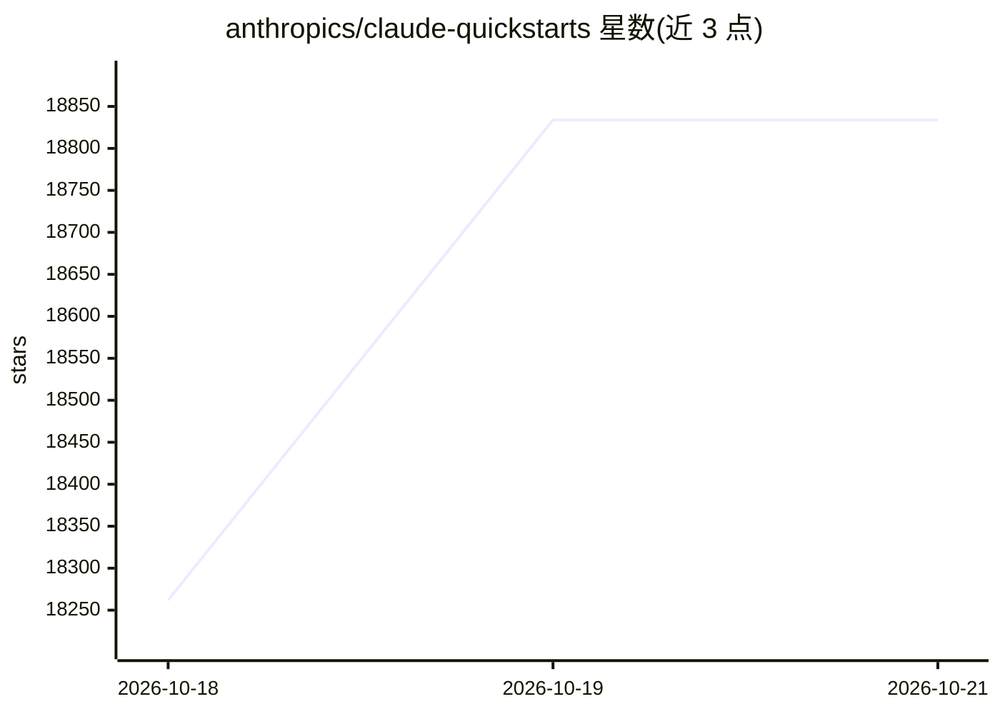

# anthropics/claude-quickstarts

⭐ 18,834 · TypeScript · MIT · 推送 2026-10-08 · [GitHub](https://github.com/anthropics/claude-quickstarts) · 组织维护

**帮助开发者快速上手 Claude API 构建应用的示例项目集**

Anthropic 维护的快速入门项目集合，每个子项目演示一类 Claude API 用法：客服 Agent、金融数据分析、桌面/浏览器计算机操作（含 toolset 最小示例）、基于 Claude Agent SDK 的自主编码 Agent、以及一批基于 Managed Agents 的集成示例（Slack、Linear、Sentry、MCP Server、知识 Wiki、定时简报等）。各子项目附独立 README 与安装说明，通用流程为克隆仓库、安装依赖、配置 API key 后运行。要求持有 Claude API key。

## 筛选速览

| 维度 | 判定 | 备注 |
|---|---|---|
| AI 角色 | `ai-ecosystem` | LLM/agent 周边工具 |
| 许可风险 | `permissive` | MIT |
| 部署形态 | `None` |  |
| 模型依赖 | locked-api |  |
| 硬件要求 | — | 无带数字的原话,不猜 |
| 安装摩擦 | `low` | 无编译、无系统依赖或容器化 |
| 成熟度 | — | 结构信号不足 |

## 动量与使用信号

- 维护:`active` — 距上次 push 9.6 天,年发版 0,33 位贡献者
- 涨星:近 1 天 **+249**(自 20261016 起算)
- 安装:github 包 `release-assets` 月下载无数据
- 平台:MACOS · 协议:MCP

## 能力要点

- 覆盖客服 Agent、金融分析、计算机操作、浏览器自动化等多类入门示例
- 含 computer_toolset_20260801 与 browser_toolset_20260801 的 Python/TypeScript 最小驱动示例
- Managed Agents 系列演示 Slack/Linear/Sentry webhook 桥接、cron 部署与 MCP Server 封装
- MIT 许可证，各子项目附独立安装说明

## 适用场景

- 作为起点搭建接入 Claude API 的客服或数据分析应用
- 学习 Claude 计算机操作与浏览器操作工具集的接口用法
- 参考 Managed Agents 示例接入 Slack、Linear 等渠道

## 场景标签

`教程课程` `数据分析` · 领域:效率与自动化

## 证据(README 行号)

> L3: Claude Quickstarts is a collection of projects designed to help developers quickly get started with building applica
> L9: ## Available Quickstarts
> L115: Each quickstart project comes with its own README and setup instructions. Generally, you'll follow these steps:

## 星数曲线

2026-10-18 18,262 → 2026-10-21 18,834（+572）

---
*卡片 v1 · prompt 1.4 · 生成 2026-10-18 · 置信度 high · 依据 README sha `888d0e12007b` · [字段定义](../../DATASET.md)*
