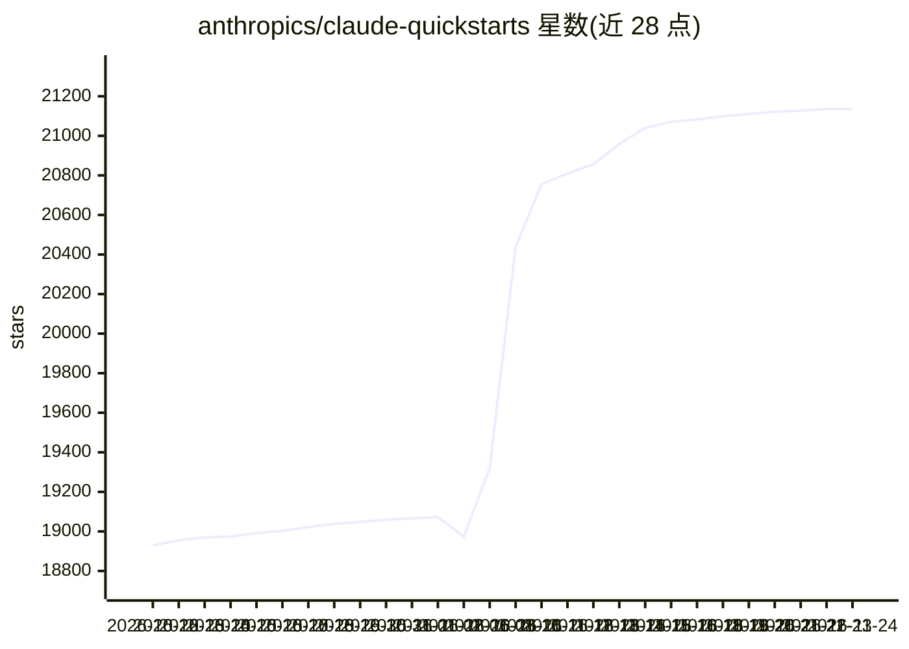

# anthropics/claude-quickstarts

⭐ 21,136 · Python · MIT · 推送 2026-11-06 · [GitHub](https://github.com/anthropics/claude-quickstarts) · 组织维护

**帮开发者用 Claude API 快速搭建可部署应用的示例集合**

Anthropic 官方的 Claude 快速入门项目集合，每个子目录提供可直接运行、可定制的基础实现：客服 Agent、金融数据分析、桌面/浏览器计算机使用、编码 Agent，以及多个基于 Claude Managed Agents 的集成示例（Slack/Linear/Sentry/MCP Server 等）。各项目自带 README 与配置说明，统一流程为克隆仓库、装依赖、设 API key 后运行。所有项目均需 Claude API key，依赖 Anthropic 服务方可使用。

## 筛选速览

| 维度 | 判定 | 备注 |
|---|---|---|
| AI 角色 | `ai-ecosystem` | LLM/agent 周边工具 |
| 许可风险 | `permissive` | MIT |
| 部署形态 | `None` |  |
| 模型依赖 | locked-api |  |
| 硬件要求 | — | 无带数字的原话,不猜 |
| 安装摩擦 | `low` | 无编译、无系统依赖或容器化 |
| 成熟度 | — | 结构信号不足 |

## 动量与使用信号

- 维护:`active` — 距上次 push 9.6 天,年发版 0,33 位贡献者
- 涨星:近 1 天 **+249**(自 20261016 起算)
- 安装:github 包 `release-assets` 月下载无数据
- 平台:MACOS · 协议:MCP

## 能力要点

- 覆盖客服、金融分析、计算机使用、浏览器自动化等多类示例项目
- 包含容器化与原生 macOS 两种计算机使用参考实现
- Managed Agents 系列演示 Slack/Linear/Sentry/MCP Server 等多种接入方式
- Browser/Computer Toolset 提供 Python 与 TypeScript 最小示例

## 适用场景

- 作为起点搭建接入 Claude API 的客服或分析类应用
- 学习计算机使用与浏览器自动化 agent 的实现模式
- 为工作区中的 Claude Managed Agents 接入 Slack、Linear 或 Sentry

## 场景标签

`浏览器自动化` `数据分析` `编码 Agent` · 领域:效率与自动化

## 证据(README 行号)

> L3: Claude Quickstarts is a collection of projects designed to help developers quickly get started with building applica
> L13: A customer support agent powered by Claude. This project demonstrates how to leverage Claude's natural language und
> L121: Each quickstart project comes with its own README and setup instructions. Generally, you'll follow these steps:

## 星数曲线

2026-10-22 18,929 → 2026-11-24 21,136（+2,207）

---
*卡片 v1 · prompt 1.4 · 生成 2026-11-22 · 置信度 high · 依据 README sha `c67627304b58` · [字段定义](../../DATASET.md)*
