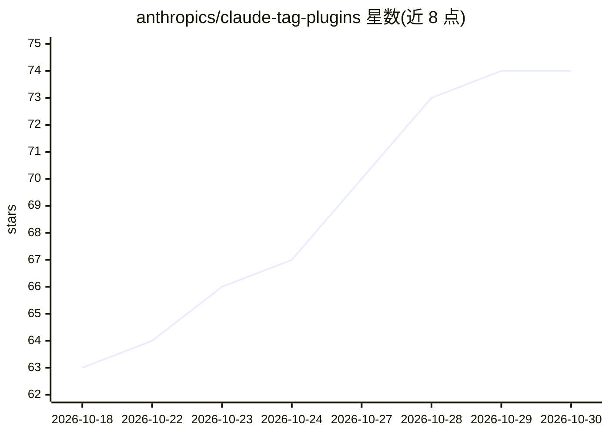

# anthropics/claude-tag-plugins

⭐ 74 · Shell · Apache-2.0 · 推送 2026-10-07 · [GitHub](https://github.com/anthropics/claude-tag-plugins) · 组织维护

**将 Claude agent 接入常见 SaaS 服务的官方插件集合**

Anthropic 维护的 @claude 插件集合，每个服务一个独立插件，覆盖 Asana、Jira、Datadog、Snowflake、Salesforce、Notion 等 20 余种 SaaS 与数据服务，能力包括任务/工单管理、SQL 查询、日志监控、文档读写等；另含数据可视化、oncall 值班、agent 调试三个辅助插件。通过 claude plugin 命令安装，技能在相关场景自动激活；插件内不含认证配置，凭证由运行时注入到出站请求。Apache 2.0 许可。

## 筛选速览

| 维度 | 判定 | 备注 |
|---|---|---|
| AI 角色 | `ai-ecosystem` | LLM/agent 周边工具 |
| 许可风险 | `permissive` | Apache-2.0 |
| 部署形态 | `None` |  |
| 模型依赖 | locked-api |  |
| 硬件要求 | — | 无带数字的原话,不猜 |
| 安装摩擦 | `low` | 无编译、无系统依赖或容器化 |
| 成熟度 | — | 结构信号不足 |

## 能力要点

- 20+ 独立服务插件，工作区可按需安装所用服务
- 统一插件结构：manifest + SKILL.md + references + scripts
- 认证由运行时注入，插件本身不含 auth 配置
- 含数据可视化、Slack oncall、agent 调试三个辅助插件

## 适用场景

- 让 Claude agent 直接查询和操作 Jira/Datadog/Snowflake 等工作服务
- 按团队实际使用的服务选择安装对应插件
- 值班场景下用 Claude 做 alert 分诊与事故调查

## 场景标签

`Agent 框架` · 领域:Agent 开发

## 证据(README 行号)

> L3: Plugins for @claude that connect the agent to common SaaS services.
> L6: ## Plugins

## 星数曲线

2026-10-18 63 → 2026-10-30 74（+11）

---
*卡片 v1 · prompt 1.4 · 生成 2026-10-24 · 置信度 high · 依据 README sha `09587b48de1f` · [字段定义](../../DATASET.md)*
