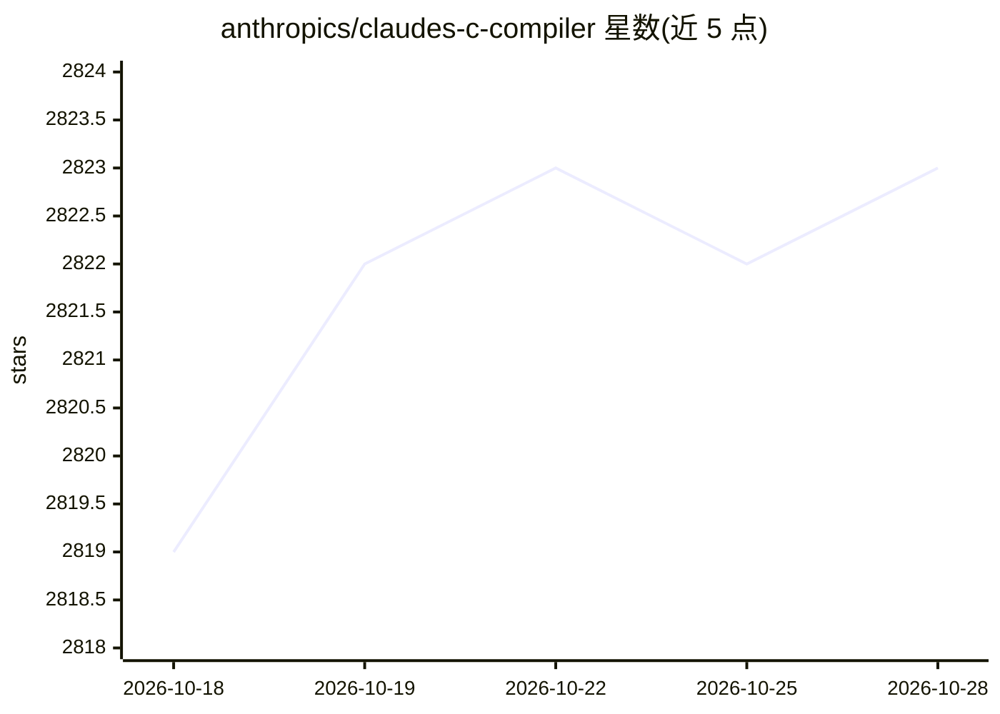

# anthropics/claudes-c-compiler

⭐ 2,823 · Rust · CC0-1.0 · 推送 2026-02-05 · [GitHub](https://github.com/anthropics/claudes-c-compiler) · 组织维护

**由 Claude Opus 4.6 编写的零依赖 Rust 实现的 C 编译器**

用 Rust 从零实现的 C 编译器（不含编译器专用依赖），前端、SSA 中间表示、优化器、代码生成、汇编器、链接器与 DWARF 调试信息生成均为自研，产出 ELF 可执行文件。目标架构覆盖 x86-64、i686、AArch64、RISC-V 64，可作为 GCC 的直接替换用于 make 等构建系统。README 声明全部代码与文档由 Claude Opus 4.6 生成、未经正确性验证，且仅限 Linux 宿主环境运行；交叉编译需另装 sysroot。构建方式为 cargo build --release。

## 筛选速览

| 维度 | 判定 | 备注 |
|---|---|---|
| AI 角色 | `ai-enhanced` | 去掉 AI 部分产品仍成立 |
| 许可风险 | `viral` | CC0-1.0 |
| 部署形态 | `None` |  |
| 模型依赖 | — | README 未给出锁定关系 |
| 硬件要求 | — | 无带数字的原话,不猜 |
| 安装摩擦 | `high` | 编译与系统依赖俱全 |
| 成熟度 | `idea` | |

## 能力要点

- 前端、SSA IR、优化器、汇编器、链接器全部从零实现，无需外部工具链
- 四个目标架构（x86-64/i686/AArch64/RISC-V 64），可编译启动的 Linux 内核
- 可作为 GCC 直接替换接入现有构建系统（兼容多数 GCC 编译参数）
- 已通过 PostgreSQL 全部 237 项回归测试、SQLite、Redis、FFmpeg 等项目构建与测试

## 适用场景

- 在 Linux 上替代 GCC 编译 C 项目并链接为 ELF 可执行文件
- 交叉编译 ARM/RISC-V/i686 目标程序（配齐 sysroot 后）
- 研究从零实现编译器的架构与各阶段设计（附 DESIGN_DOC.md）

## 场景标签

 · 领域:系统编程/编译器工具链

## 证据(README 行号)

> L3: A C compiler written entirely from scratch in Rust, targeting x86-64, i686,
> L7: Claude's C Compiler produces ELF executables without any external toolchain.
> L9: > Note: With the exception of this one paragraph that was written by a human, 100% of the code and documentation in 

## 星数曲线

2026-10-18 2,819 → 2026-10-28 2,823（+4）

---
*卡片 v1 · prompt 1.4 · 生成 2026-10-21 · 置信度 mid · 依据 README sha `7d1d77793bdd` · [字段定义](../../DATASET.md)*
