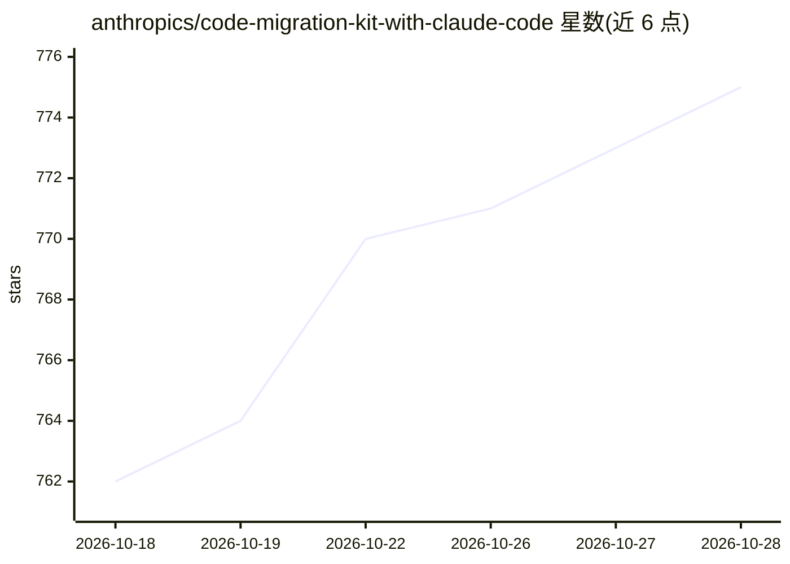

# anthropics/code-migration-kit-with-claude-code

⭐ 776 · Python · NOASSERTION · 推送 2026-07-08 · [GitHub](https://github.com/anthropics/code-migration-kit-with-claude-code) · 组织维护

**用 Claude Code 执行大规模语言迁移的提示词/模板/脚本套件**

Anthropic 发布的配套代码库，提供用 Claude Code 做跨语言整体迁移的 8 个可粘贴提示词（可行性评估→规则书→压力测试→翻译→编译→行为对齐六步）、规则书/inventory/settings 模板，以及依赖图脚本、队列运行器和构建守护等工具。机制上依赖规则书统一翻译决策、以测试套件或 parity 裁判作为完成门槛。仓库自我声明为参考代码、不积极维护，Issues 与 PR 不受监控；生产级迁移可能消耗数十亿输入 token。

## 筛选速览

| 维度 | 判定 | 备注 |
|---|---|---|
| AI 角色 | `ai-ecosystem` | LLM/agent 周边工具 |
| 许可风险 | `none` | NOASSERTION |
| 部署形态 | `None` |  |
| 模型依赖 | locked-api |  |
| 硬件要求 | — | 无带数字的原话,不猜 |
| 安装摩擦 | `low` | 无编译、无系统依赖或容器化 |
| 成熟度 | — | 结构信号不足 |

## 能力要点

- 8 个按序执行的提示词覆盖可行性评估到行为对齐六步
- 规则书模板（RULEBOOK.md）+ 依赖图脚本 + 队列运行器 + 构建守护等配套工具
- 以继承测试套件或自建 parity 裁判作为迁移完成的显式门槛
- 通过 .claude/settings.json 以配置方式禁用高开销操作

## 适用场景

- 把大型代码库从一种语言整体迁移到另一种语言（如 Zig→Rust）
- 在迁移前生成只读可行性报告，判断是否应迁移
- 以测试对齐方式验证迁移后行为与原代码一致

## 场景标签

`提示工程` · 领域:Agent 开发

## 证据(README 行号)

> L3: A starter kit for running large-scale language migrations with Claude Code: the
> L32: 4. Open Claude Code in the target repo and paste `prompts/00-feasibility.md`

## 星数曲线

2026-10-18 762 → 2026-10-28 775（+13）

---
*卡片 v1 · prompt 1.4 · 生成 2026-10-21 · 置信度 high · 依据 README sha `832e76bf4df6` · [字段定义](../../DATASET.md)*
