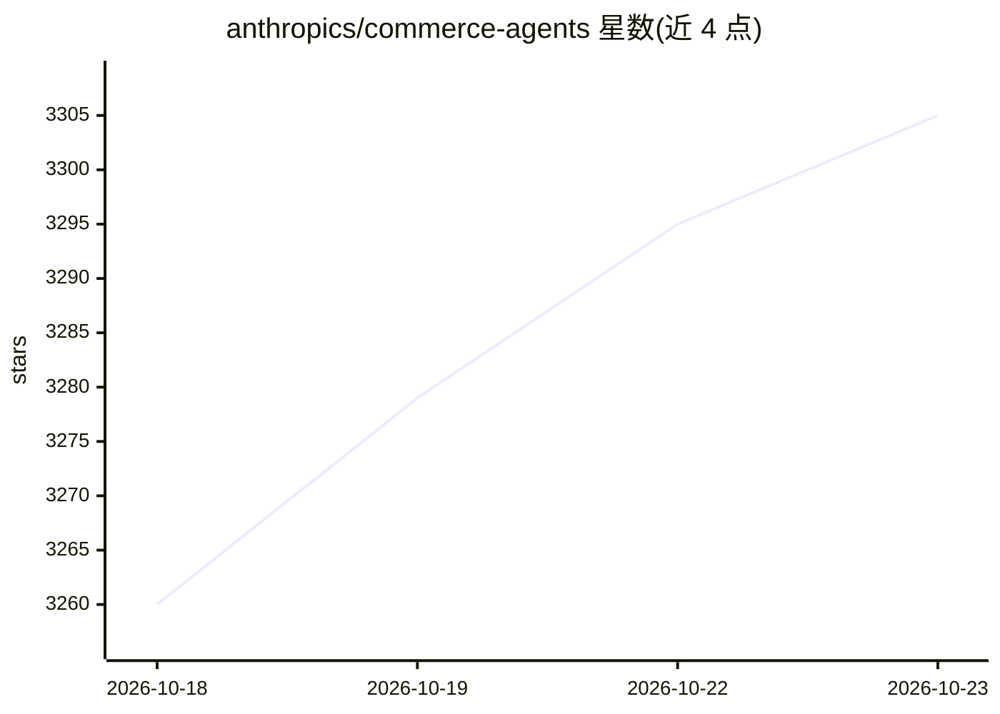

# anthropics/commerce-agents

⭐ 3,305 · Python · Apache-2.0 · 推送 2026-10-19 · [GitHub](https://github.com/anthropics/commerce-agents) · [官网](https://claude.com/solutions/commerce) · 组织维护

**给开发者：基于 Claude 构建购物与商户 agent 的参考蓝图**

Anthropic 发布的商业 agent 参考实现：包含面向顾客的 shopping agent 与面向运营人员的 merchant agent，各以提示词、技能、工具契约与门控定义一次，可在 Messages API、Claude Agent SDK 与 Managed Agents 三条路径上运行。提供零售、旅行、电信、娱乐四个可运行行业示例及 Claude Code 插件脚手架。安全机制含 fencing、溯源门控、预算上限与商户写入审批门控；示例无鉴权，实际下单与写入由宿主系统完成，需要 ANTHROPIC_API_KEY。

## 筛选速览

| 维度 | 判定 | 备注 |
|---|---|---|
| AI 角色 | `ai-ecosystem` | LLM/agent 周边工具 |
| 许可风险 | `permissive` | Apache-2.0 |
| 部署形态 | `library` | 以包/库形式分发 |
| 模型依赖 | locked-api |  |
| 硬件要求 | — | 无带数字的原话,不猜 |
| 安装摩擦 | `low` | 无编译、无系统依赖或容器化 |
| 成熟度 | — | 结构信号不足 |

## 能力要点

- 双 agent 架构：shopping agent（搜索/比价/购物车/记忆）与 merchant agent（库存/定价/活动草稿，写入需人工审批）
- 同一套定义支持三种运行路径：Messages API、Claude Agent SDK、Managed Agents
- 四个可运行行业示例（retail/travel/telecom/entertainment），API + 前端工作区
- Claude Code 插件 commerce-builder 可脚手架生成/审查自有 agent

## 适用场景

- 在自己的电商应用中嵌入面向顾客的购物助手
- 为运营团队构建带审批门控的商户后台 agent
- 参考安全门控与后端接口设计（StorefrontBackend/MerchantBackend）接入自有系统

## 场景标签

`Agent 框架` · 领域:Agent 开发

## 证据(README 行号)

> L3: Two commerce agents built on Claude: a **shopping agent** a business embeds in its app for
> L5: once (prompt, skills, tool contracts, gates) and runs on the Messages API, the Claude Agent
> L33: The Claude Code plugin scaffolds an agent on these packages against your systems, or reviews

## 星数曲线

2026-10-18 3,260 → 2026-10-23 3,305（+45）

---
*卡片 v1 · prompt 1.4 · 生成 2026-10-20 · 置信度 mid · 依据 README sha `1ff0bc6fcbdb` · [字段定义](../../DATASET.md)*
