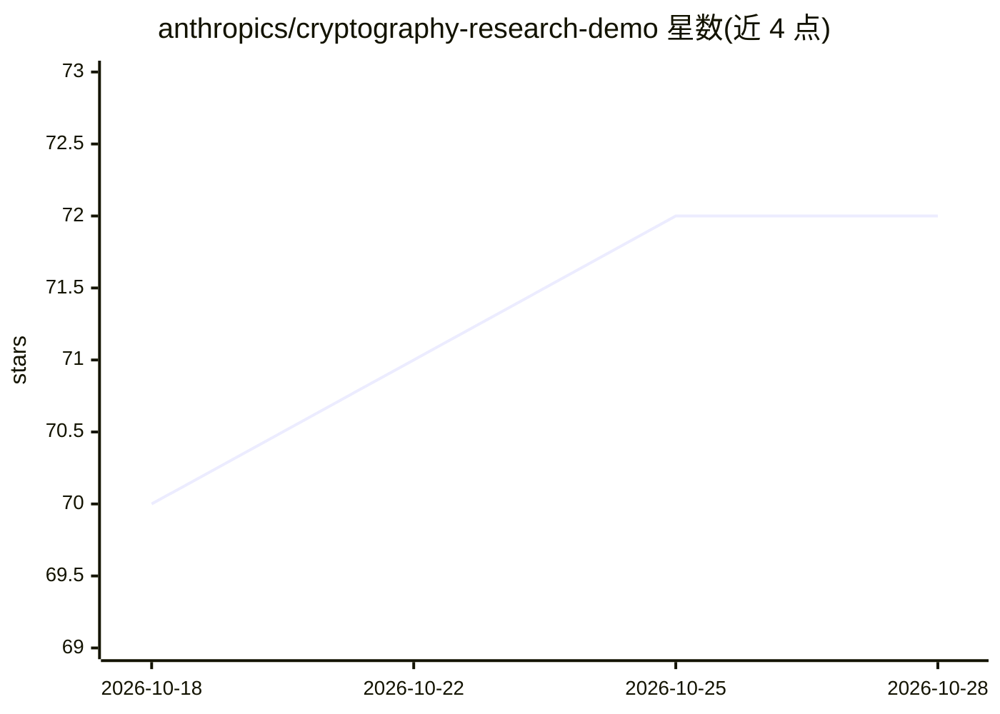

# anthropics/cryptography-research-demo

⭐ 72 · C · Apache-2.0 · 推送 2026-07-29 · [GitHub](https://github.com/anthropics/cryptography-research-demo) · 组织维护

**伴随论文的密码分析研究代码（AES/HAWK/LEA 三组件）**

Anthropic 发布的密码分析研究产物，包含三个独立组件：AES、HAWK、LEA，各对应相关论文的分析代码。仓库声明为研究产物，不再维护且不接受贡献。采用 Apache 2.0 许可证。README 未提供安装或运行说明，属于随论文发布的源码归档性质内容。

## 筛选速览

| 维度 | 判定 | 备注 |
|---|---|---|
| AI 角色 | `ai-knowledge` | 知识聚合/清单类 |
| 许可风险 | `permissive` | Apache-2.0 |
| 部署形态 | `None` |  |
| 模型依赖 | — | README 未给出锁定关系 |
| 硬件要求 | — | 无带数字的原话,不猜 |
| 安装摩擦 | `low` | 无编译、无系统依赖或容器化 |
| 成熟度 | — | 结构信号不足 |

## 能力要点

- 三个独立密码分析组件：AES/HAWK/LEA
- 代码伴随相关论文发布
- Apache 2.0 许可证

## 适用场景

- 查阅论文对应的密码分析实现代码
- 复现或参考密码分析研究方法

## 场景标签

`科研工具` · 领域:学习与行业

## 证据(README 行号)

> L1: Research artifact. Not maintained and not accepting contributions.
> L3: Cryptanalysis code accompanying the associated papers. Three independent

## 星数曲线

2026-10-18 70 → 2026-10-28 72（+2）

---
*卡片 v1 · prompt 1.4 · 生成 2026-10-24 · 置信度 mid · 依据 README sha `2c6b9eb5886d` · [字段定义](../../DATASET.md)*
