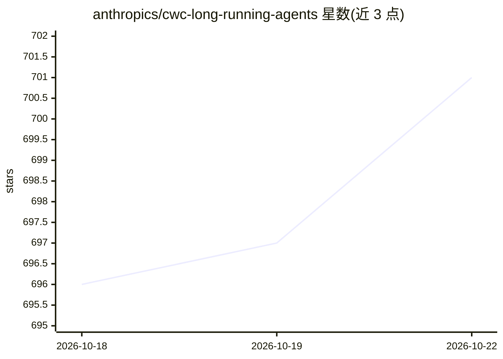

# anthropics/cwc-long-running-agents

⭐ 702 · Shell · Apache-2.0 · 推送 2026-05-13 · [GitHub](https://github.com/anthropics/cwc-long-running-agents) · 组织维护

**长时运行 Claude Agent 的测试组件示例集：钩挂与子代理模式**

Anthropic 为 Code with Claude 2026 活动发布的示例仓库，把 Claude Code 内置 /goal 的生成器/评估器循环拆解为可单独阅读、复制组装的原语：默认失败契约（test-results.json + verify-gate.sh 强制先读证据再写通过）、无 Write/Edit 工具的新鲜上下文评估器子代理、agent 自维护的 PROGRESS.md 与 commit-on-stop.sh 交接。含 kill-switch 与 steer 两个操作员控制钩挂，并给出 Agent SDK 的 PreToolUse/Stop 回调对应关系。README 明确声明为演示活动产物，不维护且不接受贡献。

## 筛选速览

| 维度 | 判定 | 备注 |
|---|---|---|
| AI 角色 | `ai-ecosystem` | LLM/agent 周边工具 |
| 许可风险 | `permissive` | Apache-2.0 |
| 部署形态 | `None` |  |
| 模型依赖 | locked-api |  |
| 硬件要求 | — | 无带数字的原话,不猜 |
| 安装摩擦 | `low` | 无编译、无系统依赖或容器化 |
| 成熟度 | `idea` | |

## 能力要点

- 三个独立文件组成质量循环：默认失败契约、新鲜上下文评估器、agent 自维护交接
- track-read.sh + verify-gate.sh 强制先读取证据文件才允许写入通过标记
- kill-switch 与 steer 钩挂支持中途停止与重定向
- 给出 bash while 循环示例：构建→评估→按 NEEDS_WORK 反馈重建

## 适用场景

- 为我的 Claude Code 项目组装自定义长任务 harness，按需复制单个钩挂
- 把 shell 钩挂模式翻译为 Agent SDK 的 PreToolUse/Stop 回调
- 学习如何用结构化文件约束 agent 的完成判定与证据链

## 场景标签

`编码 Agent` · 领域:编码与开发

## 证据(README 行号)

> L3: Claude Code's built-in `/goal` command gives you a generator/evaluator loop out of the box: set a completion conditi
> L17: Two more operator-control hooks are included for when you want to watch or intervene. The same patterns translate d

## 星数曲线

2026-10-18 696 → 2026-10-22 701（+5）

---
*卡片 v1 · prompt 1.4 · 生成 2026-10-21 · 置信度 high · 依据 README sha `bf055f6b44cb` · [字段定义](../../DATASET.md)*
