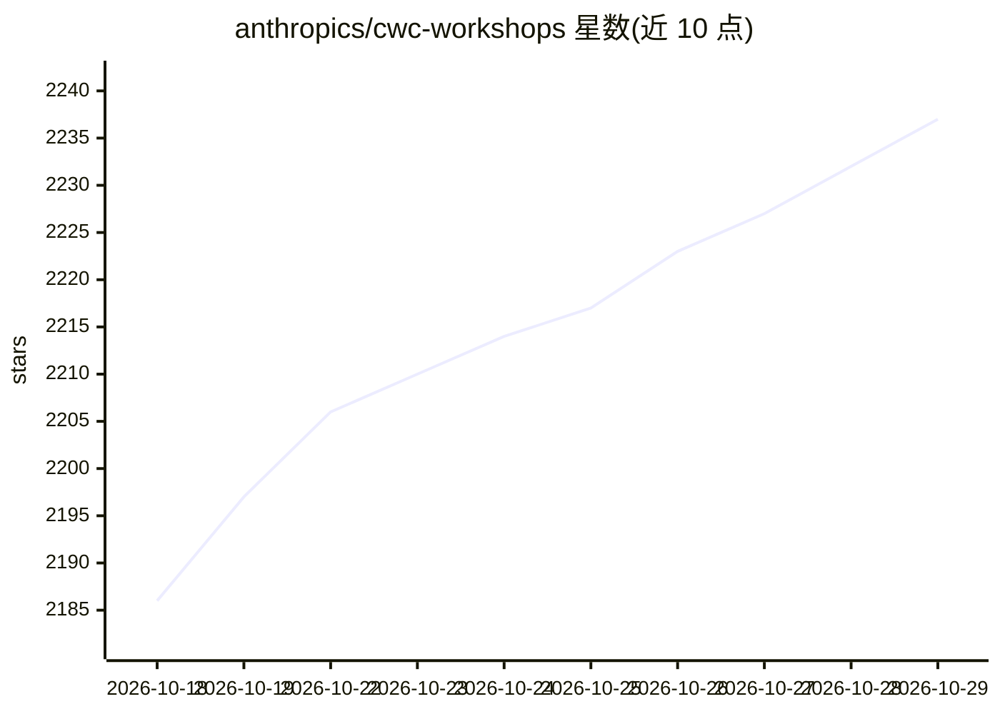

# anthropics/cwc-workshops

⭐ 2,237 · TypeScript · Apache-2.0 · 推送 2026-10-16 · [GitHub](https://github.com/anthropics/cwc-workshops) · 组织维护

**Anthropic 官方 Code with Claude 工作坊材料合集**

Anthropic 举办的 Code with Claude 系列工作坊的教学材料仓库，含 9 个独立工作坊目录：模型选型与评测扫描、多智能体拆解、AI 辅助产品工作流、托管 Agent 构建、Agent 对抗赛、记忆机制、评测驱动开发、M&A 多智能体研究与 SEC 研究台等，均围绕 Claude Code、Skills、MCP 与 Claude Managed Agents 展开。仓库声明不再维护且不接受贡献，采用 Apache 2.0 许可，未提供安装说明。

## 筛选速览

| 维度 | 判定 | 备注 |
|---|---|---|
| AI 角色 | `ai-knowledge` | 知识聚合/清单类 |
| 许可风险 | `permissive` | Apache-2.0 |
| 部署形态 | `None` |  |
| 模型依赖 | locked-api |  |
| 硬件要求 | — | 无带数字的原话,不猜 |
| 安装摩擦 | `low` | 无编译、无系统依赖或容器化 |
| 成熟度 | — | 结构信号不足 |

## 能力要点

- 9 个工作坊覆盖模型选型、多智能体、记忆、评测驱动开发等主题
- 材料基于 Claude Code Skills、MCP 与 Claude Managed Agents
- Apache License 2.0 开源

## 适用场景

- 学习 Claude Code 与 Managed Agents 的官方工作坊材料
- 参考评测驱动 Agent 开发与多智能体架构的教学案例
- 自学 AI 辅助产品工作流与 Agent 记忆机制

## 场景标签

`教程课程` · 领域:学习与行业

## 证据(README 行号)

> L5: Materials from Anthropic-run **Code with Claude** workshops.
> L9: - `rightmodel/` — *Picking the Right Model*: use a Claude Code SKILL to audit an LLM eval suite and sweep it across 

## 星数曲线

2026-10-18 2,186 → 2026-10-29 2,237（+51）

---
*卡片 v1 · prompt 1.4 · 生成 2026-10-21 · 置信度 high · 依据 README sha `6238aa6fb9d9` · [字段定义](../../DATASET.md)*
