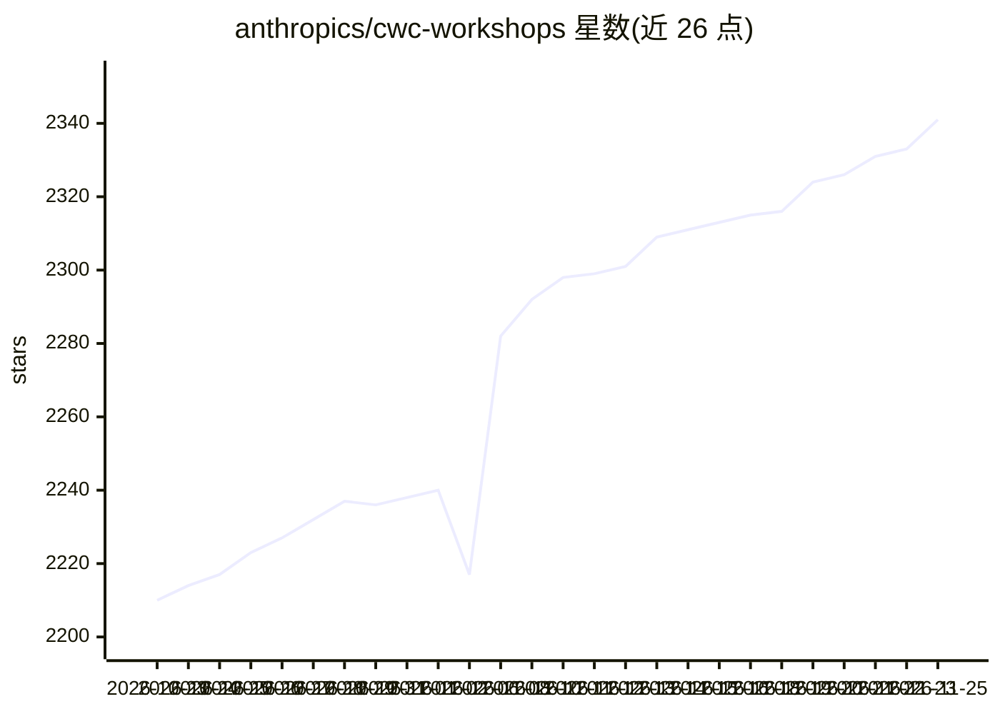

# anthropics/cwc-workshops

⭐ 2,341 · TypeScript · Apache-2.0 · 推送 2026-11-04 · [GitHub](https://github.com/anthropics/cwc-workshops) · 组织维护

**Anthropic Code with Claude 工作坊教程材料合集**

Anthropic 主办的 Code with Claude 工作坊材料仓库，含 9 个工作坊目录，覆盖模型选型评估、多 Agent 系统组合、Claude Code 工作流、Managed Agent 构建、记忆机制、评估驱动开发与 Messages API 基础功能演示等主题。README 声明不再维护且不接受贡献。许可为 Apache 2.0。

## 筛选速览

| 维度 | 判定 | 备注 |
|---|---|---|
| AI 角色 | `ai-knowledge` | 知识聚合/清单类 |
| 许可风险 | `permissive` | Apache-2.0 |
| 部署形态 | `None` |  |
| 模型依赖 | locked-api |  |
| 硬件要求 | — | 无带数字的原话,不猜 |
| 安装摩擦 | `low` | 无编译、无系统依赖或容器化 |
| 成熟度 | — | 结构信号不足 |

## 能力要点

- 9 个工作坊材料目录，覆盖从模型选型到生产级 Agent 开发
- 含评估驱动的 Agent 开发教程（两层评分器：程序化指标 + LLM-as-judge）
- 基于 Claude Managed Agents、Skills、MCP 等平台的实践练习

## 适用场景

- 按工作坊材料学习 Claude 平台的 Agent 构建功能
- 参考评估驱动的 Agent 开发流程与打分方案
- 了解多 Agent 系统、记忆与工具调用的组合方式

## 场景标签

`教程课程` · 领域:学习与行业

## 证据(README 行号)

> L5: Materials from Anthropic-run **Code with Claude** workshops.
> L9: - `rightmodel/` — *Picking the Right Model*: use a Claude Code SKILL to audit an LLM eval suite and sweep it across 

## 星数曲线

2026-10-23 2,210 → 2026-11-25 2,341（+131）

---
*卡片 v1 · prompt 1.4 · 生成 2026-11-23 · 置信度 high · 依据 README sha `cbaaae5fccb8` · [字段定义](../../DATASET.md)*
