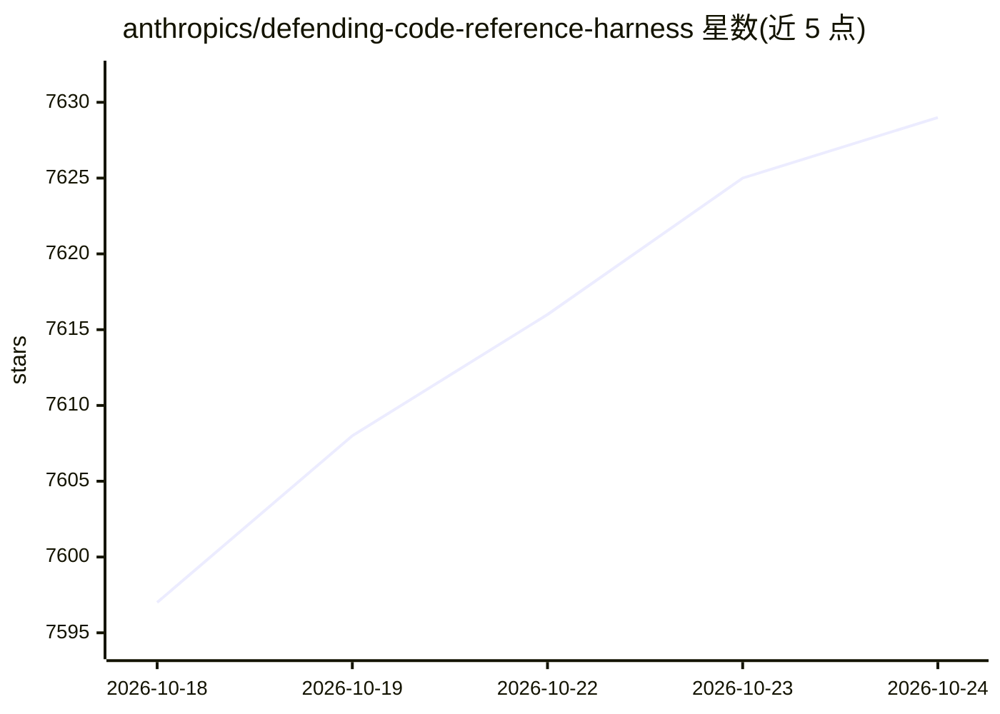

# anthropics/defending-code-reference-harness

⭐ 7,629 · Python · NOASSERTION · 推送 2026-08-06 · [GitHub](https://github.com/anthropics/defending-code-reference-harness) · [官网](https://claude.com/blog/using-llms-to-secure-source-code) · 组织维护

**用 Claude 自主发现与修复代码漏洞的参考流水线**

Anthropic 发布的开源参考实现：基于 Claude Code 的技能（威胁建模、静态扫描、triage、补丁）与自主扫描流水线，走完 recon→find→verify→dedupe→report→patch 七阶段循环。参考实现面向 C/C++ 内存漏洞（ASAN 构建、gVisor 沙箱隔离），可通过 /customize 技能移植到其他语言与漏洞类型；支持经 Bedrock/Vertex/Azure 访问 Claude API。仓库声明不再维护、不接受贡献。

## 筛选速览

| 维度 | 判定 | 备注 |
|---|---|---|
| AI 角色 | `ai-ecosystem` | LLM/agent 周边工具 |
| 许可风险 | `none` | NOASSERTION |
| 部署形态 | `self-host` | docker 或自建部署 |
| 模型依赖 | locked-api |  |
| 硬件要求 | — | 无带数字的原话,不猜 |
| 安装摩擦 | `low` | 无编译、无系统依赖或容器化 |
| 成熟度 | — | 结构信号不足 |

## 能力要点

- 七阶段自主流水线：build/recon/find/verify/dedupe/report/patch
- find 代理在隔离容器中构造畸形输入并以 ASAN 崩溃 3/3 验证，独立 grader 代理复现
- gVisor 沙箱 + 出站仅限 Claude API 的代理隔离
- 交互式技能生成 THREAT_MODEL.md、VULN-FINDINGS、TRIAGE 与候选补丁

## 适用场景

- 对 C/C++ 库做自主漏洞扫描、验证与补丁生成
- 把流水线定制移植到自己的服务与技术栈
- 跨多次扫描做统一 triage 与优先级排序
- 在日志中做检测与响应演练（内置植入攻击的演示目标）

## 场景标签

`网络安全` `编码 Agent` · 领域:编码与开发

## 证据(README 行号)

> L3: A reference implementation for autonomous vulnerability discovery and
> L22: > This repository is an open-source reference implementation based on general
> L25: > can be used with whatever access you have to Claude APIs (including

## 星数曲线

2026-10-18 7,597 → 2026-10-24 7,629（+32）

---
*卡片 v1 · prompt 1.4 · 生成 2026-10-20 · 置信度 mid · 依据 README sha `8ef209c23d51` · [字段定义](../../DATASET.md)*
