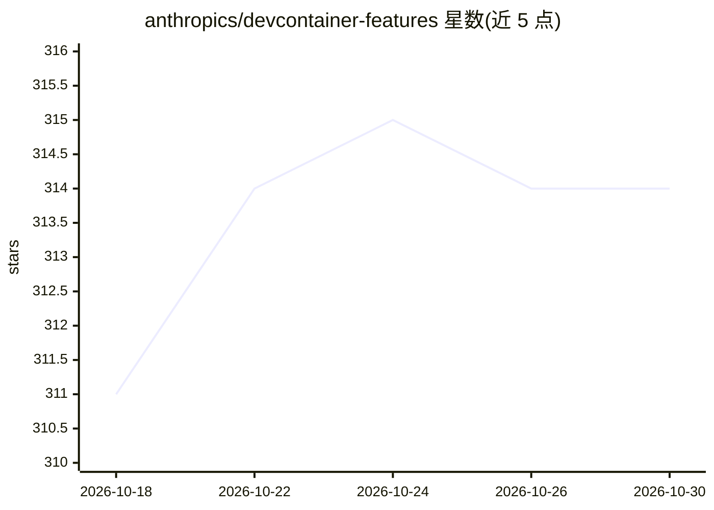

# anthropics/devcontainer-features

⭐ 314 · Shell · MIT · 推送 2025-12-16 · [GitHub](https://github.com/anthropics/devcontainer-features) · 组织维护

**开发者用：在 Dev Container 中安装 Claude Code CLI 的功能包**

Anthropic 维护的 Dev Container Features 仓库，提供一个安装 Claude Code CLI 的 feature，通过在 devcontainer.json 的 features 字段引用 ghcr.io 镜像即可启用。该 feature 自动依赖 Node.js，缺失时会自动安装。仓库同时提供 devcontainer CLI 的测试与发布命令，采用 MIT 许可证。面向使用 VS Code Dev Container 等容器化开发环境的开发者。

## 筛选速览

| 维度 | 判定 | 备注 |
|---|---|---|
| AI 角色 | `ai-ecosystem` | LLM/agent 周边工具 |
| 许可风险 | `permissive` | MIT |
| 部署形态 | `None` |  |
| 模型依赖 | locked-api |  |
| 硬件要求 | — | 无带数字的原话,不猜 |
| 安装摩擦 | `low` | 无编译、无系统依赖或容器化 |
| 成熟度 | — | 结构信号不足 |

## 能力要点

- 提供安装 Claude Code CLI 的 Dev Container feature
- 通过 devcontainer.json 引用 ghcr.io 镜像启用
- 自动依赖并按需安装 Node.js

## 适用场景

- 在容器化开发环境中预装 Claude Code CLI
- 为团队统一定义含 Claude Code 的开发容器配置

## 场景标签

 · 领域:开发工具/容器化环境

## 证据(README 行号)

> L3: This repository contains Dev Container Features, including one that installs the Claude Code CLI.
> L13:     "ghcr.io/anthropics/devcontainer-features/claude-code:1.0": {}

## 星数曲线

2026-10-18 311 → 2026-10-30 314（+3）

---
*卡片 v1 · prompt 1.4 · 生成 2026-10-21 · 置信度 high · 依据 README sha `7f0367cd083e` · [字段定义](../../DATASET.md)*
