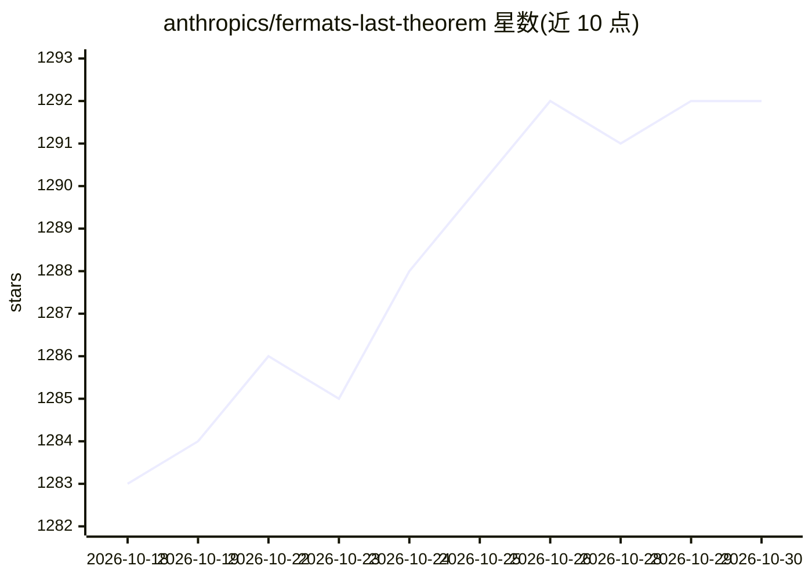

# anthropics/fermats-last-theorem

⭐ 1,292 · Lean · Apache-2.0 · 推送 2026-09-24 · [GitHub](https://github.com/anthropics/fermats-last-theorem) · 组织维护

**Lean 4 机器检验的费马大定理完整证明研究工件**

在 Lean 4.33.1 与 Mathlib 上对费马大定理（Frey–Serre–Ribet–Wiles 路线）的完整机器检验证明，含 60,475 个模块、29,511 条定理。构建强制证明仅依赖 Lean 三条标准公iom，无 sorry/自定义公理；另经 comparator 独立挑战核验与 Rust 编写的第二内核 nanoda 复核。Lean 源码由 AI agent 在人类开源 Lean 基础上生成，以 Lean 内核为裁判，面向检验而非阅读。提供离线可浏览的 HTML 证明文档。需 Linux/macOS 与 elan，自行编译 Mathlib，内存与磁盘开销大。声明为研究工件、不维护、不接受贡献。

## 筛选速览

| 维度 | 判定 | 备注 |
|---|---|---|
| AI 角色 | `ai-knowledge` | 知识聚合/清单类 |
| 许可风险 | `permissive` | Apache-2.0 |
| 部署形态 | `library` | 以包/库形式分发 |
| 模型依赖 | — | README 未给出锁定关系 |
| 硬件要求 | — | 无带数字的原话,不猜 |
| 安装摩擦 | `low` | 无编译、无系统依赖或容器化 |
| 成熟度 | — | 结构信号不足 |

## 能力要点

- 完整 Lean 4 机器检验证明，构建强制仅依赖 propext/Classical.choice/Quot.sound 三条标准公理
- 经 comparator 挑战核验与独立 Rust 内核 nanoda 双重复核
- html/ 目录（约 390 MB）提供 29,511 条定理的离线可浏览证明网页与依赖图
- Lean 源码由 AI agent 基于人类开源 Lean 生成，Lean 内核为最终裁判

## 适用场景

- 形式化数学研究者核查费马大定理的机器检验证明
- 通过离线 HTML 页面逐条浏览证明路线与定理依赖关系
- 按 README 步骤自行重建并复核整个证明

## 场景标签

 · 领域:形式化数学/定理证明

## 证据(README 行号)

> L1: # Fermat's Last Theorem in Lean 4
> L100: above and `tools/docs-site/` the program that generated them. The Lean sources were produced by AI agents building
> L107: Copyright 2026 Anthropic, PBC; released under the Apache License 2.0 (`LICENSE`). Portions derive from three

## 星数曲线

2026-10-18 1,283 → 2026-10-30 1,292（+9）

---
*卡片 v1 · prompt 1.4 · 生成 2026-10-21 · 置信度 high · 依据 README sha `168515a16006` · [字段定义](../../DATASET.md)*
