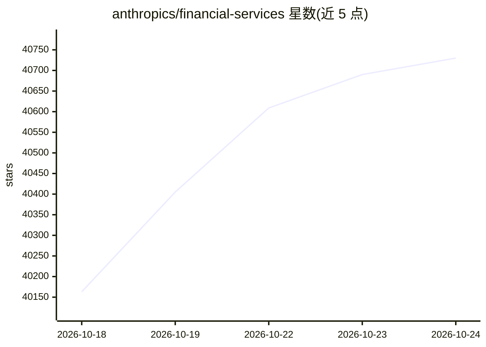

# anthropics/financial-services

⭐ 40,730 · Python · Apache-2.0 · 推送 2026-09-21 · [GitHub](https://github.com/anthropics/financial-services) · 组织维护

**面向金融从业者的 Claude 参考智能体、技能与数据连接器合集**

由 Anthropic 维护的金融服务领域参考仓库，提供端到端工作流 Agent（Pitch Agent、Market Researcher、GL Reconciler 等）、按 FSI 垂直方向打包的插件（技能、斜杠命令、MCP 连接器），以及 Managed Agents 部署模板。同一套系统提示与技能可通过 Claude Cowork 插件安装，也可经 /v1/agents API 部署。所有输出均标注为供专业人士审阅的分析草稿，不构成投资建议，不执行交易。全部内容基于 markdown/JSON 文件，无构建步骤。

## 筛选速览

| 维度 | 判定 | 备注 |
|---|---|---|
| AI 角色 | `ai-native` | 本体是模型或模型工具 |
| 许可风险 | `permissive` | Apache-2.0 |
| 部署形态 | `None` |  |
| 模型依赖 | locked-api |  |
| 硬件要求 | — | 无带数字的原话,不猜 |
| 安装摩擦 | `low` | 无编译、无系统依赖或容器化 |
| 成熟度 | — | 结构信号不足 |

## 动量与使用信号

- 维护:`active` — 距上次 push 26.4 天,年发版 0,12 位贡献者
- 涨星:近 1 天 **+125**(自 20261016 起算)
- 安装:github 包 `release-assets` 月下载无数据
- 平台:— · 协议:MCP

## 能力要点

- 10 个端到端工作流 Agent，以自包含插件形式提供
- 9 个垂直插件，含 comps/DCF/LBO 等建模技能与斜杠命令
- 集中管理 11 个 MCP 数据连接器（Daloopa、FactSet、Morningstar 等）
- 支持 Cowork 插件安装与 Claude Managed Agents API 两种部署方式

## 适用场景

- 为投行/卖方工作流生成路演材料与可比公司分析
- 财报后自动更新模型并起草研究笔记
- 基金运营中对账、月末结账与估值复核
- KYC 文档解析与规则引擎筛查

## 场景标签

`金融量化` `文档解析` · 领域:知识与检索

## 证据(README 行号)

> L3: Reference agents, skills, and data connectors for the financial-services workflows we see most — investment banking,
> L5: Everything here is available **two ways from one source**: install it as a Claude Cowork plugin, or deploy it throug
> L12: - **Agents** — named, end-to-end workflow agents (Pitch Agent, Market Researcher, GL Reconciler, …). Each ships as 

## 星数曲线

2026-10-18 40,163 → 2026-10-24 40,730（+567）

---
*卡片 v1 · prompt 1.4 · 生成 2026-10-18 · 置信度 high · 依据 README sha `c354fdc6b2b9` · [字段定义](../../DATASET.md)*
