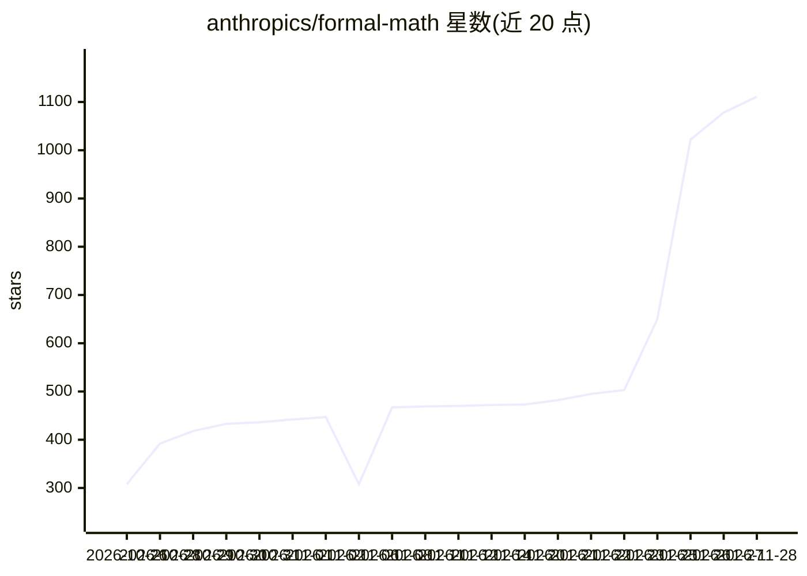

# anthropics/formal-math

⭐ 1,111 · Lean · Apache-2.0 · 推送 2026-11-27 · [GitHub](https://github.com/anthropics/formal-math) · 组织维护

**Anthropic 发布的 Lean 4 机器校验数学形式化项目集**

Anthropic 发布的机器校验 Lean 4 形式化仓库，每个子目录是独立的 Lake 项目，含工具链固定版本、README 与构建说明，遵循 Palomar 提交模板（Challenge.lean/Solution.lean/comparator.json）。收录 ζ 函数零点单性、3SUM/APSP 复杂度下界、ETH 反驳、VP≠VNP 等结果的逐条形式化证明。CI 按变更目录选择性构建，通过 lake build 无 sorry 且经独立 nanoda 内核与 landrun 沙箱的 Palomar 注册表验收检查判定通过。仓库整体采用 Apache-2.0 许可。

## 筛选速览

| 维度 | 判定 | 备注 |
|---|---|---|
| AI 角色 | `ai-knowledge` | 知识聚合/清单类 |
| 许可风险 | `permissive` | Apache-2.0 |
| 部署形态 | `None` |  |
| 模型依赖 | — | README 未给出锁定关系 |
| 硬件要求 | — | 无带数字的原话,不猜 |
| 安装摩擦 | `low` | 无编译、无系统依赖或容器化 |
| 成熟度 | — | 结构信号不足 |

## 能力要点

- 4 个自包含 Lean 4 / Mathlib 形式化项目，工具链版本逐项目固定
- CI 仅对变更项目触发构建，PR 复用增量 Lake 构建
- 验收依赖独立 nanoda 内核与 landrun 沙箱的 comparator 检查，可本地运行脚本复现
- 其中两项形式化（eth、vp-vnp）标注为 Claude 产出

## 适用场景

- 复现或审阅 Riemann zeta 零点、3SUM 下界等形式化证明
- 按模板向 Palomar 提交新的 Lean 4 形式化项目
- 在 CI 中对 Lean 项目做增量构建与验收校验

## 场景标签

 · 领域:形式化数学/定理证明

## 证据(README 行号)

> L3: Machine-checked Lean 4 formalizations published by Anthropic. Each subdirectory is a self-contained Lake project wit
> L7: |`zeta23/`|More than two thirds of the zeros of the Riemann zeta function are simple and on the critical line (Alpög

## 星数曲线

2026-10-26 308 → 2026-11-28 1,111（+803）

---
*卡片 v1 · prompt 1.4 · 生成 2026-11-28 · 置信度 high · 依据 README sha `bd1fce4547a8` · [字段定义](../../DATASET.md)*
