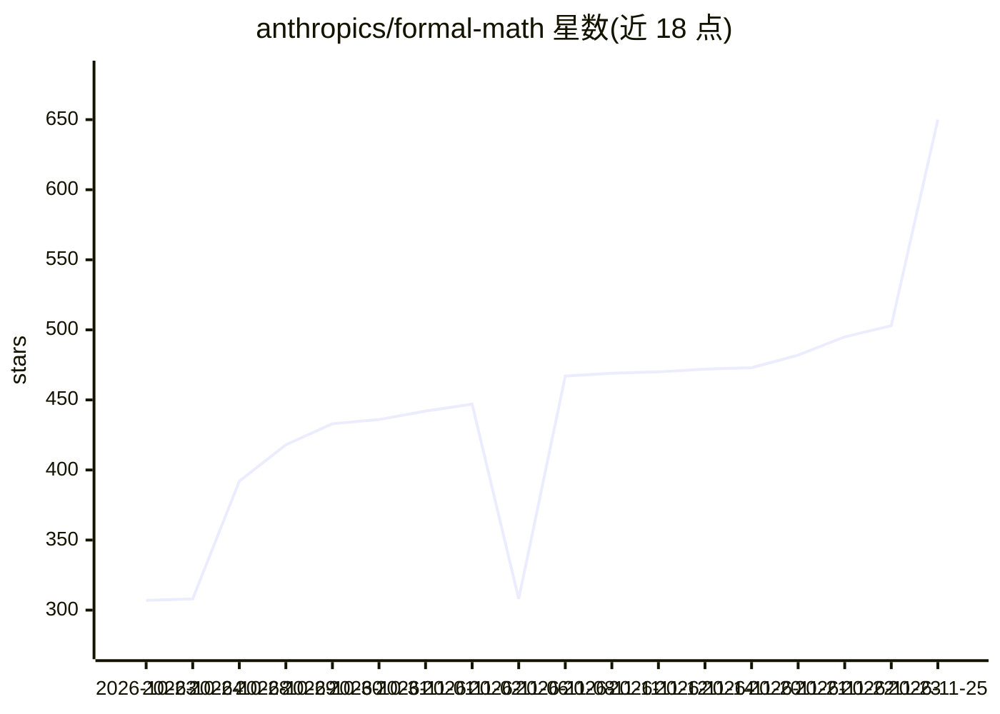

# anthropics/formal-math

⭐ 650 · Lean · Apache-2.0 · 推送 2026-11-23 · [GitHub](https://github.com/anthropics/formal-math) · 组织维护

**Anthropic 发布的 Lean 4 机器校验数学形式化项目集**

Anthropic 发布的形式化数学仓库，包含多个自包含的 Lean 4 Lake 项目（zeta23、3sum-apsp、eth 等），每个项目固定工具链版本并按 Palomar 提交模板组织（Challenge/Solution/comparator.json/formalization.yaml）。CI 按变更目录增量构建，通过标准为 lake build 无 sorry，且经 lean4export、独立 nanoda 内核与 landrun 沙箱的 Palomar 注册表验收检查。Apache-2.0 许可。

## 筛选速览

| 维度 | 判定 | 备注 |
|---|---|---|
| AI 角色 | `ai-knowledge` | 知识聚合/清单类 |
| 许可风险 | `permissive` | Apache-2.0 |
| 部署形态 | `None` |  |
| 模型依赖 | — | README 未给出锁定关系 |
| 硬件要求 | — | 无带数字的原话,不猜 |
| 安装摩擦 | `low` | 无编译、无系统依赖或容器化 |
| 成熟度 | — | 结构信号不足 |

## 能力要点

- 多个自包含 Lean 4 项目，各自固定 lean4/Mathlib 工具链版本
- CI 增量构建：仅重建变更模块，PR 复用缓存
- 验收链含 lean4export、独立 nanoda 内核与 landrun 沙箱
- 含 Claude 生成的 ETH 反证形式化（eth/ 项目）

## 适用场景

- 查阅具体数学定理的机器校验 Lean 4 证明
- 按 Palomar 模板组织自己的形式化项目
- 在本地复跑 comparator 验收脚本校验项目

## 场景标签

`科研工具` · 领域:学习与行业

## 证据(README 行号)

> L3: Machine-checked Lean 4 formalizations published by Anthropic. Each subdirectory is a self-contained Lake project wit
> L7: |`zeta23/`|More than two thirds of the zeros of the Riemann zeta function are simple and on the critical line (Alpög

## 星数曲线

2026-10-23 307 → 2026-11-25 650（+343）

---
*卡片 v1 · prompt 1.4 · 生成 2026-11-25 · 置信度 high · 依据 README sha `30df62f97901` · [字段定义](../../DATASET.md)*
