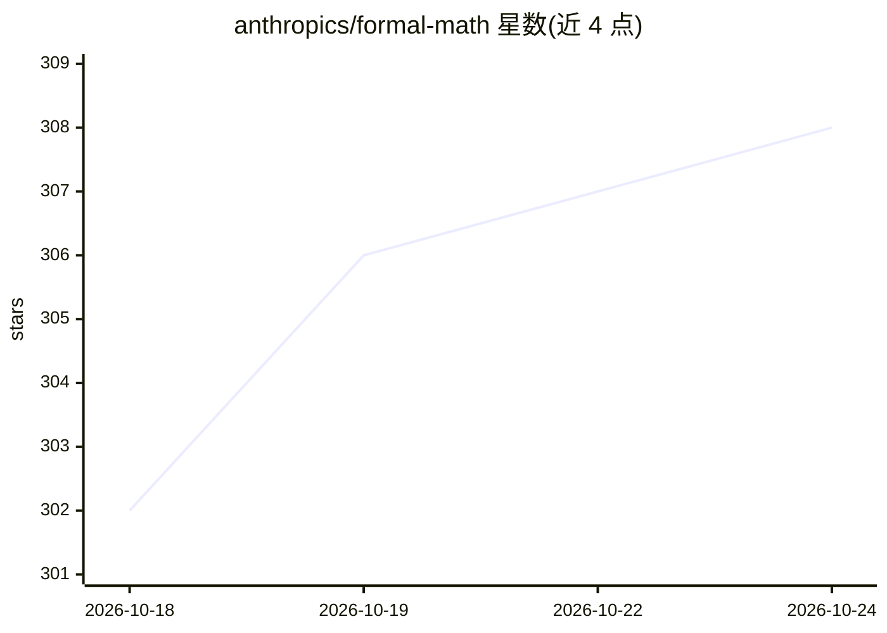

# anthropics/formal-math

⭐ 308 · Lean · Apache-2.0 · 推送 2026-10-06 · [GitHub](https://github.com/anthropics/formal-math) · 组织维护

**Anthropic 发布的 Lean 4 机器检验数学形式化项目集合**

存放 Anthropic 发布的机器检验 Lean 4 形式化证明的仓库，每个子目录是独立的 Lake 项目，带各自的工具链锁定与构建说明。现有项目包括 Riemann zeta 函数零点简单性（zeta23）与 3SUM/APSP 算法复杂度界（3sum-apsp）等形式化。项目遵循 Palomar 提交模板，CI 通过 lake build 与 Palomar 注册表验收检查（含独立 nanoda 内核与 landrun 沙箱）验证证明无 sorry。面向形式化数学与定理证明研究者。

## 筛选速览

| 维度 | 判定 | 备注 |
|---|---|---|
| AI 角色 | `ai-knowledge` | 知识聚合/清单类 |
| 许可风险 | `permissive` | Apache-2.0 |
| 部署形态 | `None` |  |
| 模型依赖 | — | README 未给出锁定关系 |
| 硬件要求 | — | 无带数字的原话,不猜 |
| 安装摩擦 | `low` | 无编译、无系统依赖或容器化 |
| 成熟度 | — | 结构信号不足 |

## 能力要点

- 每个子目录为独立 Lake 项目，自带工具链锁定与构建说明
- CI 以 lake build 与 Palomar comparator 检查验证证明不含 sorry
- 跨证明复检使用独立 nanoda 内核与 landrun 沙箱

## 适用场景

- 查阅已机器检验的数学定理形式化证明
- 按模板向仓库新增 Lean 形式化项目
- 作为 Palomar 注册表提交的项目来源

## 场景标签

 · 领域:形式化数学/定理证明

## 证据(README 行号)

> L3: Machine-checked Lean 4 formalizations published by Anthropic. Each subdirectory is a self-contained Lake project wit
> L7: |`zeta23/`|More than two thirds of the zeros of the Riemann zeta function are simple and on the critical line (Alpög

## 星数曲线

2026-10-18 302 → 2026-10-24 308（+6）

---
*卡片 v1 · prompt 1.4 · 生成 2026-10-21 · 置信度 high · 依据 README sha `bd66e9c8fd67` · [字段定义](../../DATASET.md)*
