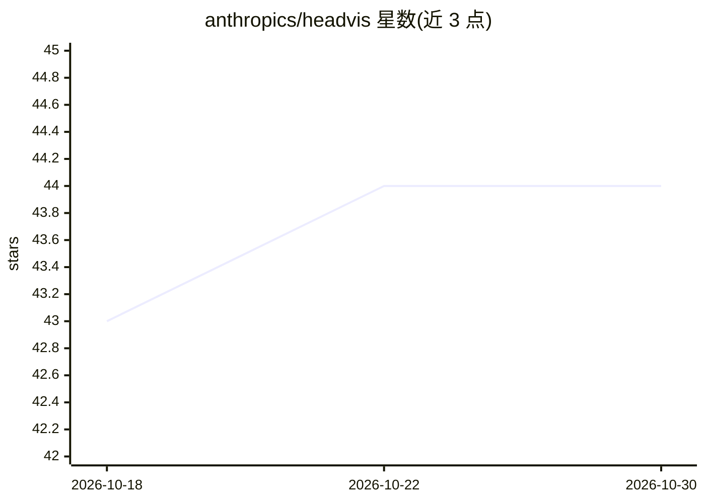

# anthropics/headvis

⭐ 44 · Svelte · Apache-2.0 · 推送 2026-05-04 · [GitHub](https://github.com/anthropics/headvis) · 组织维护

**Transformer 注意力头可视化工具，面向可解释性研究者**

Anthropic 发布的注意力头可视化参考实现：静态优先的前端，从 data/ 目录读取数据即可无后端运行；展示各 head 的高激活序列、注意力模式、induction score 等 head 级指标及 Q/K/O/V 空间的 PCA/UMAP 投影，可选用稀疏字典将注意力边分解为特征对。数据管线 server.py 为骨架代码，数据格式契约写在 docstring 中，预期工作流是交给 Claude Code 针对具体模型实现并运行。仓库声明不再维护、不接受贡献。

## 筛选速览

| 维度 | 判定 | 备注 |
|---|---|---|
| AI 角色 | `ai-ecosystem` | LLM/agent 周边工具 |
| 许可风险 | `permissive` | Apache-2.0 |
| 部署形态 | `library` | 以包/库形式分发 |
| 模型依赖 | — | README 未给出锁定关系 |
| 硬件要求 | — | 无带数字的原话,不猜 |
| 安装摩擦 | `low` | 无编译、无系统依赖或容器化 |
| 成熟度 | — | 结构信号不足 |

## 能力要点

- 静态优先前端，data/ 填充后无后端即可运行
- head 级指标：induction score、previous-token score、熵等
- Q/K/O/V 空间 PCA/UMAP 投影与注意力边特征分解（需 SAE）
- data_pipeline.py/server.py 为骨架，由 Claude Code 按 docstring 契约实现

## 适用场景

- 研究 Transformer 模型中各个注意力头的行为
- 检查特定 head 在数据集上的高激活序列与注意力模式
- 结合稀疏字典做注意力边的特征归因分析

## 场景标签

`科研工具` · 领域:学习与行业

## 证据(README 行号)

> L5: A visualization tool for attention heads in transformer language models. Pick a head, see its top-activating sequenc
> L3: > **Reference implementation.** This repository is not maintained and not accepting contributions. Report security i

## 星数曲线

2026-10-18 43 → 2026-10-30 44（+1）

---
*卡片 v1 · prompt 1.4 · 生成 2026-10-25 · 置信度 high · 依据 README sha `f7c136c410cd` · [字段定义](../../DATASET.md)*
