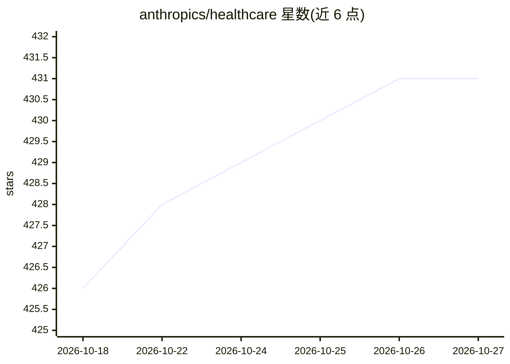

# anthropics/healthcare

⭐ 431 · JavaScript · 推送 2026-08-27 · [GitHub](https://github.com/anthropics/healthcare) · 组织维护

**面向医疗健康工作的 Claude 技能插件包，含托管 MCP 服务**

Anthropic 维护的单一 Claude 插件：打包支付方、医疗提供方、药企与通用工程场景的 10 项技能（临床笔记结构化提取、临床试验方案生成、FHIR 对接、ICD-10/CPT 编码、欺诈骗保筛查、预先授权审查等），技能按需加载。附带 7 个已连接的 MCP 服务（CMS Coverage、ICD10、PubMed 等，多数为托管端点，FHIR 与合同分析器为本地 stdio 打包）。通过 /plugin marketplace 命令安装，v1 各独立插件以弃用别名形式归并。

## 筛选速览

| 维度 | 判定 | 备注 |
|---|---|---|
| AI 角色 | `ai-ecosystem` | LLM/agent 周边工具 |
| 许可风险 | `none` | — |
| 部署形态 | `None` |  |
| 模型依赖 | locked-api |  |
| 硬件要求 | — | 无带数字的原话,不猜 |
| 安装摩擦 | `low` | 无编译、无系统依赖或容器化 |
| 成熟度 | — | 结构信号不足 |

## 能力要点

- 10 项医疗健康技能：临床提取、试验方案、编码、预先授权、欺诈筛查等
- 7 个已连接 MCP 服务，托管端点无需自行搭建
- 技能仅在相关时加载
- 包含客户自托管 MCP 服务源码与 Managed Agents 模板

## 适用场景

- 从临床文档提取结构化数据与计费编码
- 对接医院 FHIR R4 服务器拉取并分析患者数据
- 筛查 Medicare/Medicaid 索赔中的欺诈、浪费与滥用

## 场景标签

`文档解析` · 领域:知识与检索

## 证据(README 行号)

> L3: One plugin for healthcare work: skills for payer, provider, pharma, and general engineering, with hosted MCP servers
> L8: /plugin marketplace add anthropics/healthcare
> L9: /plugin install healthcare@healthcare
> L29: Hosted, no setup — referenced from the plugin's `.mcp.json`:

## 星数曲线

2026-10-18 426 → 2026-10-27 431（+5）

---
*卡片 v1 · prompt 1.4 · 生成 2026-10-21 · 置信度 high · 依据 README sha `43f34b85c332` · [字段定义](../../DATASET.md)*
