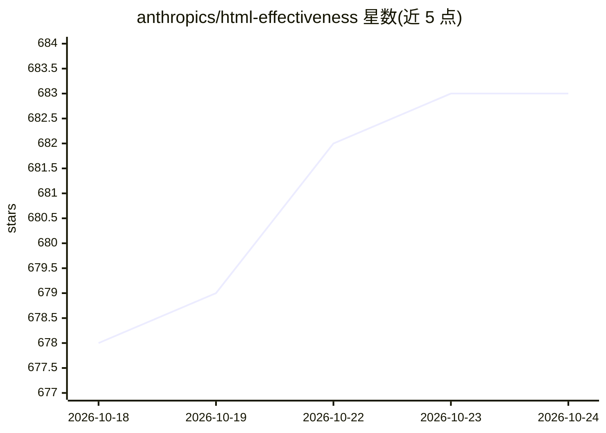

# anthropics/html-effectiveness

⭐ 683 · HTML · MIT · 推送 2026-07-03 · [GitHub](https://github.com/anthropics/html-effectiveness) · 组织维护

**HTML 作为输出格式的独立示例集，配合作者博客文章**

一组自包含的独立 .html 示例页面集合，配合同名博客文章演示 HTML 作为灵活输出格式的多种用例，覆盖代码评审、设计系统、幻灯片、状态报告与小型交互编辑器等。每个文件无构建步骤、无依赖，克隆仓库后在浏览器中打开 index.html 或任意编号文件即可查看。示例中的产品名与数据均为虚构（占位品牌 Acme）。以 MIT 许可发布，附 SECURITY.md 漏洞报告说明。

## 筛选速览

| 维度 | 判定 | 备注 |
|---|---|---|
| AI 角色 | `ai-knowledge` | 知识聚合/清单类 |
| 许可风险 | `permissive` | MIT |
| 部署形态 | `None` |  |
| 模型依赖 | — | README 未给出锁定关系 |
| 硬件要求 | — | 无带数字的原话,不猜 |
| 安装摩擦 | `low` | 无编译、无系统依赖或容器化 |
| 成熟度 | — | 结构信号不足 |

## 能力要点

- 每个示例为自包含 .html 文件，无构建步骤、无依赖
- 覆盖代码评审、设计系统、幻灯片、状态报告、交互编辑器等用例
- 提供 index.html 分类索引页，浏览器直接打开即可

## 适用场景

- 浏览 HTML 输出格式的多样化用例参考
- 配合原博客文章理解 HTML 作为输出格式的用法
- 直接在浏览器中查看各独立示例

## 场景标签

 · 领域:Web 开发/示例资源

## 证据(README 行号)

> L3: A gallery of standalone HTML examples that accompany the blog post on using HTML
> L5: step, no dependencies) demonstrating a different use case — from code review and

## 星数曲线

2026-10-18 678 → 2026-10-24 683（+5）

---
*卡片 v1 · prompt 1.4 · 生成 2026-10-21 · 置信度 mid · 依据 README sha `170e99ea3d8f` · [字段定义](../../DATASET.md)*
