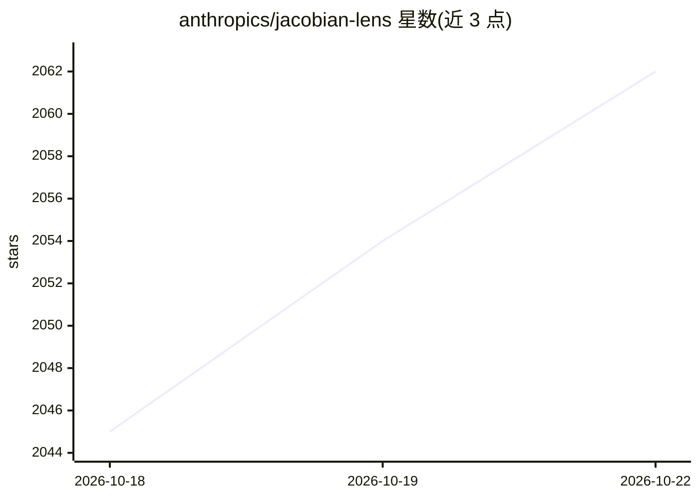

# anthropics/jacobian-lens

⭐ 2,062 · Python · Apache-2.0 · 推送 2026-10-10 · [GitHub](https://github.com/anthropics/jacobian-lens) · 组织维护

**语言模型可解释性研究工具：用 Jacobian 透镜读出内部激活的词汇倾向**

论文《Verbalizable Representations Form a Global Workspace in Language Models》的配套参考实现。在开源权重 decoder transformer 上拟合 Jacobian lens：以文本语料上的平均输入–输出 Jacobian 作为线性传输算子，把任意层、任意位置的残差流向量映射到末层基，再用模型自身的 unembedding 解码为按词表排序的 token 列表；并提供层×位置的交互式切片可视化。示例使用 Qwen，其他 HuggingFace decoder 可适配。以 pip 源码安装方式提供，附带端到端 notebook。仓库标注为参考实现，不再维护、不接受贡献。

## 筛选速览

| 维度 | 判定 | 备注 |
|---|---|---|
| AI 角色 | `ai-ecosystem` | LLM/agent 周边工具 |
| 许可风险 | `permissive` | Apache-2.0 |
| 部署形态 | `library` | 以包/库形式分发 |
| 模型依赖 | — | README 未给出锁定关系 |
| 硬件要求 | — | 无带数字的原话,不猜 |
| 安装摩擦 | `medium` | 含编译或系统依赖之一 |
| 成熟度 | — | 结构信号不足 |

## 能力要点

- 以平均输入–输出 Jacobian 实现层间线性传输并用模型自身 unembedding 解码
- 支持在自有模型与语料上拟合 lens，可用 JacobianLens.merge() 并行合并
- 交互式层×位置切片可视化（点击选格、rank 追踪图表与热图）
- 附带 walkthrough.ipynb 端到端笔记本

## 适用场景

- 检查语言模型中间层激活趋向输出哪些词
- 复现论文中的全局工作空间可解释性分析
- 对自有 HuggingFace decoder 拟合并应用 Jacobian lens

## 场景标签

 · 领域:AI 可解释性研究

## 证据(README 行号)

> L8: The Jacobian lens reads out what an internal activation is disposed to make the
> L24: This repo fits the lens on open-weights decoder transformers, applies it, and

## 星数曲线

2026-10-18 2,045 → 2026-10-22 2,062（+17）

---
*卡片 v1 · prompt 1.4 · 生成 2026-10-21 · 置信度 high · 依据 README sha `dfb576b5a435` · [字段定义](../../DATASET.md)*
