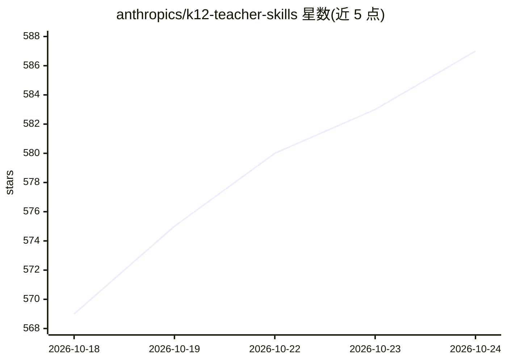

# anthropics/k12-teacher-skills

⭐ 587 · Python · Apache-2.0 · 推送 2026-10-14 · [GitHub](https://github.com/anthropics/k12-teacher-skills) · 组织维护

**给 K-12 教师的四个 Claude 代理技能与配套评测框架**

Anthropic 与 Learning Commons 共同开发的教师用 agent 技能源码仓库，包含四个技能：教案创建（对齐课程标准）、分层教学改编、备课助手、数学理解检测。技能依赖 Claude for Teachers 内置的 Learning Commons Knowledge Graph 连接器获取全美学术标准。评测框架在 evals 目录提供。Claude for Teachers 用户免安装，其他环境可经 Claude Code 手动加载插件。

## 筛选速览

| 维度 | 判定 | 备注 |
|---|---|---|
| AI 角色 | `ai-ecosystem` | LLM/agent 周边工具 |
| 许可风险 | `permissive` | Apache-2.0 |
| 部署形态 | `None` |  |
| 模型依赖 | locked-api |  |
| 硬件要求 | — | 无带数字的原话,不猜 |
| 安装摩擦 | `low` | 无编译、无系统依赖或容器化 |
| 成熟度 | — | 结构信号不足 |

## 能力要点

- 四个 K-12 技能：教案创建/分层改编/备课/理解检测
- 依赖 Learning Commons 知识图谱连接器访问全美 50 州学术标准
- 附评测框架（evals）
- 以 Claude Code 插件形式提供手动安装途径

## 适用场景

- 生成对齐课程标准的课堂教案
- 把现有教案改编为不同水平的分层版本
- 为数学标准生成带误解项干扰题的形成性检测

## 场景标签

`AI 写作` · 领域:内容生成

## 证据(README 行号)

> L2: Source code and evaluation framework for the agent skills that are included with Claude for Teachers.
> L12: The skills are written to make effective use of the Learning Commons Knowledge Graph Claude connector that is inclu
> L21: Load the plugin or skills manually. For instance, in Claude Code:

## 星数曲线

2026-10-18 569 → 2026-10-24 587（+18）

---
*卡片 v1 · prompt 1.4 · 生成 2026-10-21 · 置信度 high · 依据 README sha `f9689d546d72` · [字段定义](../../DATASET.md)*
