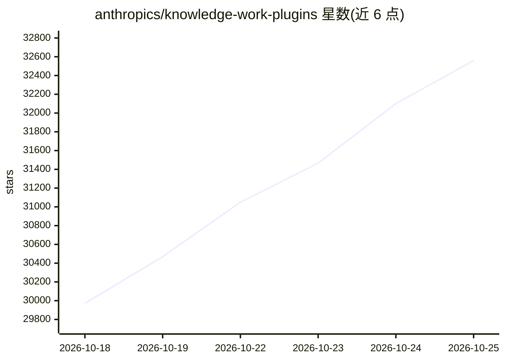

# anthropics/knowledge-work-plugins

⭐ 32,559 · Python · Apache-2.0 · 推送 2026-10-24 · [GitHub](https://github.com/anthropics/knowledge-work-plugins) · 组织维护

**面向知识工作者的 Claude 插件集（11 个职能专用插件）**

Anthropic 开源的插件仓库，包含 11 个针对具体职能（销售、客服、产品、市场、法务、财务、数据、科研等）的插件，供 Claude Cowork 使用，亦兼容 Claude Code。每个插件捆绑 skills、connectors、slash commands 与 sub-agents，通过 MCP 服务器接入 Slack、Notion、Jira、Snowflake 等外部工具。全部组件为 markdown 与 JSON 文件，无代码、无构建步骤；支持从 claude.com/plugins 安装或经 Claude Code 市场命令安装，并可自定义或创建新插件。

## 筛选速览

| 维度 | 判定 | 备注 |
|---|---|---|
| AI 角色 | `ai-native` | 本体是模型或模型工具 |
| 许可风险 | `permissive` | Apache-2.0 |
| 部署形态 | `None` |  |
| 模型依赖 | locked-api |  |
| 硬件要求 | — | 无带数字的原话,不猜 |
| 安装摩擦 | `low` | 无编译、无系统依赖或容器化 |
| 成熟度 | — | 结构信号不足 |

## 动量与使用信号

- 维护:`active` — 距上次 push 1.0 天,年发版 0,32 位贡献者
- 涨星:近 1 天 **+135**(自 20261016 起算)
- 安装:github 包 `release-assets` 月下载无数据
- 平台:— · 协议:MCP

## 能力要点

- 11 个覆盖销售/法务/财务/数据等职能的插件
- skills、commands、connectors、sub-agents 的插件结构
- 通过 .mcp.json 配置 MCP 连接器接入外部工具
- 组件均为 markdown/JSON 文件，无构建步骤

## 适用场景

- 为团队角色安装现成的 Claude 专用插件
- 按公司自有工具链与术语定制插件
- 用 cowork-plugin-management 创建新插件

## 场景标签

`AI 助手` `科研工具` · 领域:对话与助手

## 证据(README 行号)

> L3: Plugins that turn Claude into a specialist for your role, team, and company. Built for Claude Cowork, also compatibl
> L9: Each plugin bundles the skills, connectors, slash commands, and sub-agents for a specific job function. Out of the b
> L63: - **Connectors** wire Claude to the external tools your role depends on — CRMs, project trackers, data warehouses, 

## 星数曲线

2026-10-18 29,971 → 2026-10-25 32,559（+2,588）

---
*卡片 v1 · prompt 1.4 · 生成 2026-10-18 · 置信度 high · 依据 README sha `306e32da15b7` · [字段定义](../../DATASET.md)*
