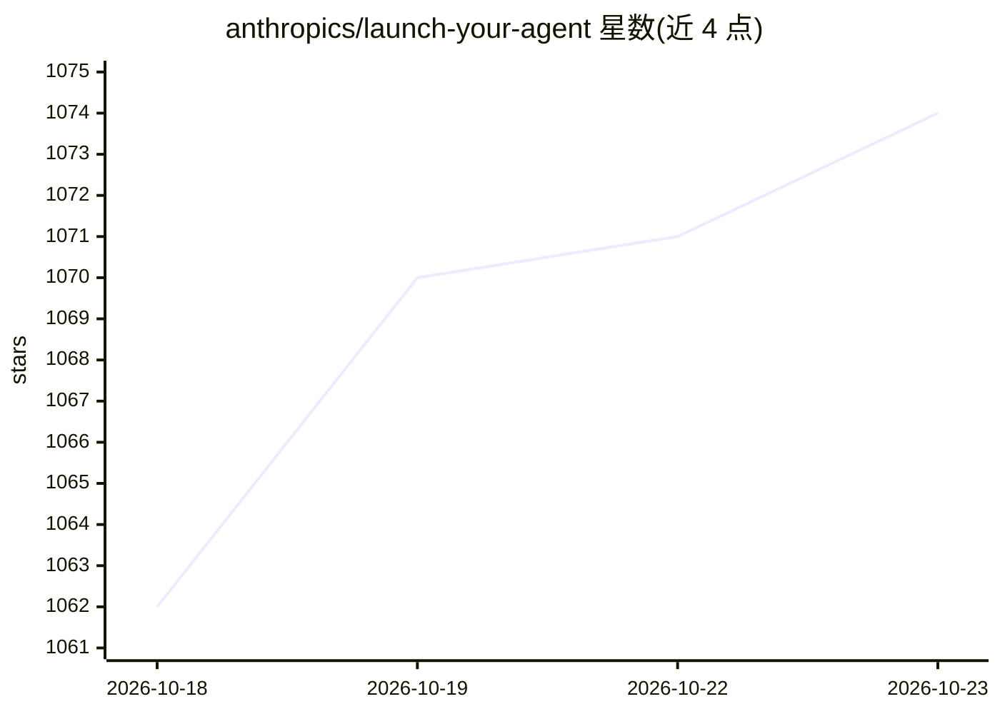

# anthropics/launch-your-agent

⭐ 1,074 · HTML · Apache-2.0 · 推送 2026-09-23 · [GitHub](https://github.com/anthropics/launch-your-agent) · 组织维护

**引导技术创始人用 Claude Code 搭建 Claude 托管 Agent 的技能包**

Anthropic 发布的 Claude Code skill 参考实现：面向想在 Claude Managed Agents (CMA) 上构建内部工具、产品组件或面向客户 agent 的技术创始人。流程分 4 阶段：访谈需求、界定并启动 v0 到用户自有账户、按自定义完成标准评分迭代、按需配置定时部署，并产出 v1/v2 后续计划。因逐步讲解原理，token 消耗高于定制 agent。官方声明不维护、不接受贡献，需自备 Claude Code 与 Anthropic API key。

## 筛选速览

| 维度 | 判定 | 备注 |
|---|---|---|
| AI 角色 | `ai-ecosystem` | LLM/agent 周边工具 |
| 许可风险 | `permissive` | Apache-2.0 |
| 部署形态 | `None` |  |
| 模型依赖 | locked-api |  |
| 硬件要求 | — | 无带数字的原话,不猜 |
| 安装摩擦 | `low` | 无编译、无系统依赖或容器化 |
| 成熟度 | — | 结构信号不足 |

## 能力要点

- 4 阶段流程：访谈→启动→评分迭代→定时部署
- 产出自有账户内的托管 agent 及可复用的 my-agent 文件夹（构建表/载荷/脚本/评测脚手架）
- 技能放入 .claude/skills/ 后由 Claude Code 自动加载，无需安装

## 适用场景

- 从想法出发在自有账户内上线一个 Claude 托管 agent
- 让 AI 通过访谈界定 v0 范围并给出 v1/v2 计划
- 给周期性任务配置定时部署的托管 agent

## 场景标签

`教程课程` · 领域:学习与行业

## 证据(README 行号)

> L3: A Claude Code skill that helps a technical founder build whatever they want on **Claude Managed Agents (CMA)** — an 
> L41: |`.claude/skills/launch-your-agent/`|The main skill: 4 phases (interview → stage & launch → grade & iterate → run w

## 星数曲线

2026-10-18 1,062 → 2026-10-23 1,074（+12）

---
*卡片 v1 · prompt 1.4 · 生成 2026-10-21 · 置信度 high · 依据 README sha `32eb41cd3552` · [字段定义](../../DATASET.md)*
