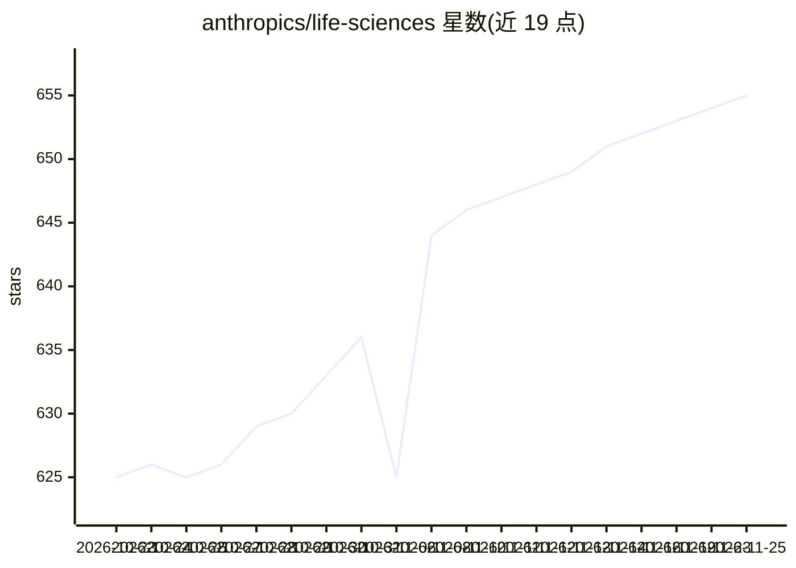

# anthropics/life-sciences

⭐ 655 · Python · 推送 2026-11-20 · [GitHub](https://github.com/anthropics/life-sciences) · 组织维护

**面向生命科学研究者的 Claude Code 技能插件市场清单**

Anthropic 维护的 Claude Code Marketplace 仓库，为生命科学研究提供领域技能（skills）：临床试验方案生成、科研选题方法论、临床试验结果概率预测、从头设计蛋白结合剂的独立复检与可开发性评估。技能以插件形式通过 /plugin marketplace add 命令安装。仓库已重新聚焦于技能，不再承载 MCP connector 插件，部分技能已移除，早期版本保留在 git 历史中。

## 筛选速览

| 维度 | 判定 | 备注 |
|---|---|---|
| AI 角色 | `ai-knowledge` | 知识聚合/清单类 |
| 许可风险 | `none` | — |
| 部署形态 | `None` |  |
| 模型依赖 | locked-api |  |
| 硬件要求 | — | 无带数字的原话,不猜 |
| 安装摩擦 | `low` | 无编译、无系统依赖或容器化 |
| 成熟度 | — | 结构信号不足 |

## 能力要点

- 提供 4 个生命科学技能：临床方案生成、科研选题、试验预测、蛋白结合剂验证
- 通过 /plugin marketplace add 一条命令接入 Claude Code
- 技能基于已发表方法论（如 Cell 2024 选题框架）
- README 声明长期只托管 marketplace.json，不承载 MCP 服务器

## 适用场景

- 为医疗器械或药物生成符合 FDA/NIH 要求的临床试验方案
- 评估在研项目的风险与可行性，做科研战略规划
- 估计已注册临床试验达成目标的概率并获取引用报告
- 对从头设计的蛋白结合剂做独立复预测与开发性画像

## 场景标签

`科研工具` · 领域:学习与行业

## 证据(README 行号)

> L3: This marketplace provides skills for life sciences research. Skills are domain-specific workflows that extend Claude
> L44: This repository has been refocused on skills, so it no longer carries MCP connector plugins. If you installed one, 

## 星数曲线

2026-10-23 625 → 2026-11-25 655（+30）

---
*卡片 v1 · prompt 1.4 · 生成 2026-11-24 · 置信度 high · 依据 README sha `d70fff9b6537` · [字段定义](../../DATASET.md)*
