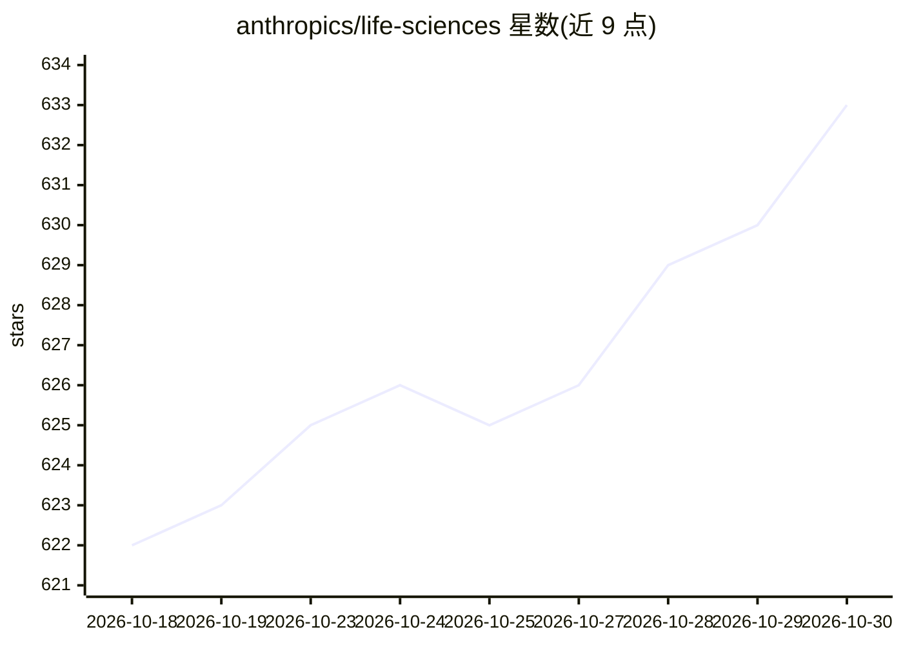

# anthropics/life-sciences

⭐ 633 · Python · 推送 2026-10-28 · [GitHub](https://github.com/anthropics/life-sciences) · 组织维护

**面向生命科学的 Claude Code 插件市场：MCP 服务器与技能集合**

由 Anthropic 维护的生命科学插件市场仓库，托管 marketplace.json，通过 Claude Code 的 /plugin 机制安装。收录 6 个远程 MCP 服务器（PubMed、BioRender、Synapse、Wiley Scholar Gateway、Consensus、Cortellis、AdisInsight）、1 个本地 MCP 服务器（10x Genomics Cloud），以及单细胞 RNA-seq 质控、Allotrope 数据转换、Nextflow 生信流程、scvi-tools、科研选题等技能。除 PubMed 外多数服务器需配置账号凭证，部分需付费订阅。

## 筛选速览

| 维度 | 判定 | 备注 |
|---|---|---|
| AI 角色 | `ai-ecosystem` | LLM/agent 周边工具 |
| 许可风险 | `none` | — |
| 部署形态 | `None` |  |
| 模型依赖 | locked-api |  |
| 硬件要求 | — | 无带数字的原话,不猜 |
| 安装摩擦 | `low` | 无编译、无系统依赖或容器化 |
| 成熟度 | — | 结构信号不足 |

## 能力要点

- 提供生命科学领域的远程/本地 MCP 服务器与技能插件
- 通过 /plugin marketplace add 一条命令接入 Claude Code
- 技能覆盖单细胞质控、nf-core 流程（rnaseq/sarek/atacseq）、scvi-tools 分析等
- 按无认证/免费账号/付费订阅三档标注各插件凭证要求

## 适用场景

- 在 Claude Code 中直接检索 PubMed 文献
- 实验科学家无需生信训练即可本地运行 nf-core 大规模组学流程
- 对单细胞 RNA-seq 数据执行标准化质量控制
- 借助 Consensus/Cortellis 等服务做证据综合与药物监管情报查询

## 场景标签

`科研工具` · 领域:学习与行业

## 证据(README 行号)

> L3: This marketplace provides MCP (Model Context Protocol) servers and skills for life sciences tools. Install these plu
> L6: - **MCP Servers**: Connect to external services like PubMed, BioRender, Synapse, and more
> L7: - **Skills**: Domain-specific workflows and analysis capabilities that extend Claude's expertise

## 星数曲线

2026-10-18 622 → 2026-10-30 633（+11）

---
*卡片 v1 · prompt 1.4 · 生成 2026-10-21 · 置信度 high · 依据 README sha `80e3c6229b54` · [字段定义](../../DATASET.md)*
