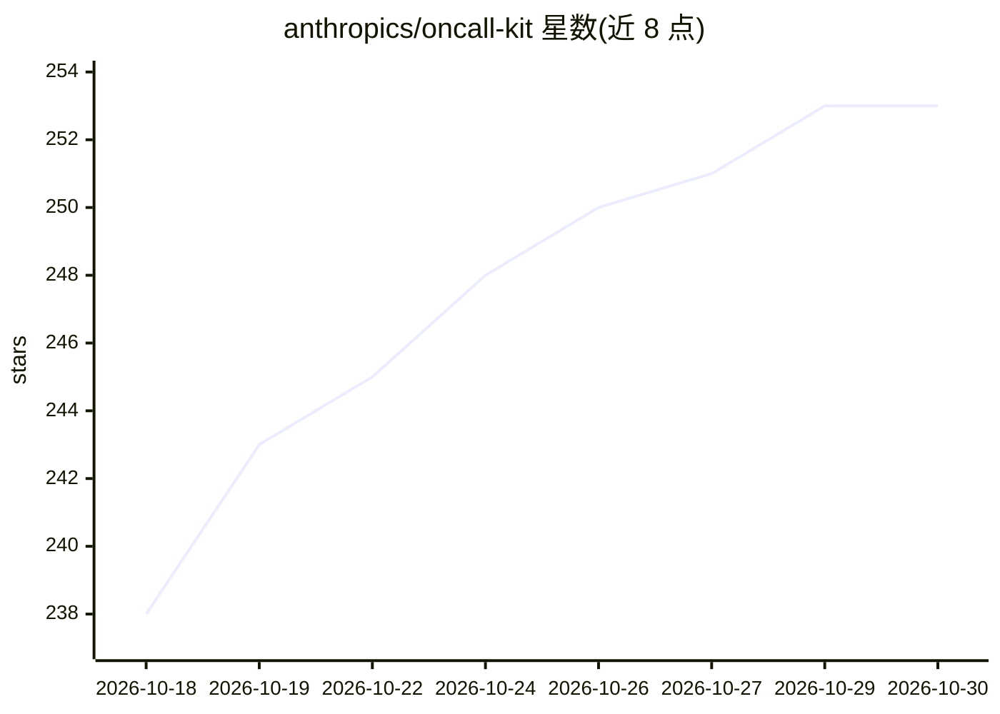

# anthropics/oncall-kit

⭐ 253 · Python · Apache-2.0 · 推送 2026-08-06 · [GitHub](https://github.com/anthropics/oncall-kit) · 组织维护

**Claude 辅助值班应急响应的入门套件：从事件历史生成排障手册**

由 Anthropic 发布的参考实现套件，把 Claude 引入 Slack 值班频道：告警触发后自动调查并发布带证据链接的初步诊断，人类决定处置，Claude 跟踪修复落地并将经验写入 lessons.md。安装分五个带人工审批门禁的阶段：发现工具连接、挖掘 30-90 天历史事件生成手册草稿、人工访谈补全策略、保留事件盲测校验（≥70% 通过门禁）、安装例程。技能不绑定具体厂商，通过 STACK.md 把抽象能力映射到实际工具。官方声明不维护、不接受贡献。

## 筛选速览

| 维度 | 判定 | 备注 |
|---|---|---|
| AI 角色 | `ai-native` | 本体是模型或模型工具 |
| 许可风险 | `permissive` | Apache-2.0 |
| 部署形态 | `None` |  |
| 模型依赖 | locked-api |  |
| 硬件要求 | — | 无带数字的原话,不猜 |
| 安装摩擦 | `low` | 无编译、无系统依赖或容器化 |
| 成熟度 | — | 结构信号不足 |

## 能力要点

- 五阶段门禁式安装，每阶段需人工签核
- 从历史事件自动挖掘生成排障手册草稿，带来源标注
- 技能按能力而非厂商编写，STACK.md 映射到实际工具
- 保留事件盲测校验与影子期机制，人类决定所有处置

## 适用场景

- 在 Slack 值班频道接入 Claude 做告警初步诊断
- 把团队历史事件沉淀为可复用的排障手册
- 自动生成周一交接与周期性状态报告

## 场景标签

`知识库管理` `工作流自动化` · 领域:效率与自动化

## 证据(README 行号)

> L5: Put Claude in your team's incident channel. When an alert fires, it
> L50: - Claude posts a grounded first-pass diagnosis — every claim linked to
> L105: |Diagnosis|The `triage` skill: classify the symptom, load the matching reference file, check `lessons.md` for know

## 星数曲线

2026-10-18 238 → 2026-10-30 253（+15）

---
*卡片 v1 · prompt 1.4 · 生成 2026-10-22 · 置信度 high · 依据 README sha `bd863b16bc81` · [字段定义](../../DATASET.md)*
