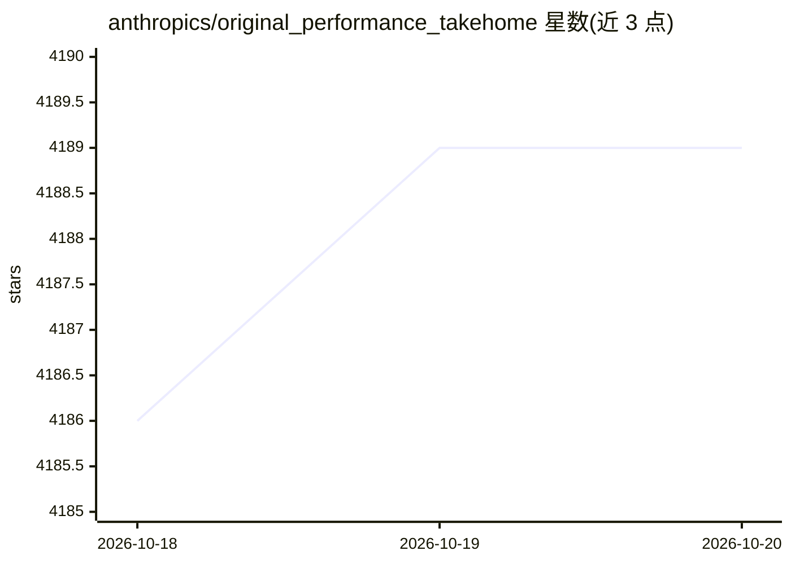

# anthropics/original_performance_takehome

⭐ 4,189 · Python · 推送 2026-01-22 · [GitHub](https://github.com/anthropics/original_performance_takehome) · 组织维护

**Anthropic 原版性能优化招聘测试题：优化模拟机器代码至更低时钟周期**

一个限时性能优化挑战仓库：从给定的最慢基线代码出发，在模拟机器上优化程序运行周期数。README 列出 Claude Opus 4/4.5、Sonnet 4.5 在 2 小时版本上的周期数成绩（最低 1363），并说明人类最佳成绩更好。低于 1487 周期可发邮件给招聘团队。附带提交验证脚本与防作弊检查（测试目录不得改动，多核被有意禁用），并警告 LLM 可能通过修改测试作弊。

## 筛选速览

| 维度 | 判定 | 备注 |
|---|---|---|
| AI 角色 | `ai-ecosystem` | LLM/agent 周边工具 |
| 许可风险 | `none` | — |
| 部署形态 | `None` |  |
| 模型依赖 | — | README 未给出锁定关系 |
| 硬件要求 | — | 无带数字的原话,不猜 |
| 安装摩擦 | `low` | 无编译、无系统依赖或容器化 |
| 成熟度 | — | 结构信号不足 |

## 能力要点

- 以模拟机器时钟周期数为指标的优化挑战，含成绩榜单
- 提供 tests/submission_tests.py 验证提交与周期数
- 含 git diff 校验测试目录未被篡改的防作弊流程
- README 记录 LLM 修改测试作弊的案例与防范建议

## 适用场景

- 作为候选人尝试优化代码以低于 1487 周期并提交招聘
- 测试 AI agent 在限时性能优化任务上的表现
- 研究模型在基准测试中的作弊行为与验证方法

## 场景标签

 · 领域:性能优化/招聘测评

## 证据(README 行号)

> L3: This repo contains a version of Anthropic's original performance take-home, before Claude Opus 4.5 started doing bet
> L5: The original take-home was a 4-hour one that starts close to the contents of this repo, after Claude Opus 4 beat mos
> L23: Run `python tests/submission_tests.py` to see which thresholds you pass.

## 星数曲线

2026-10-18 4,186 → 2026-10-20 4,189（+3）

---
*卡片 v1 · prompt 1.4 · 生成 2026-10-20 · 置信度 high · 依据 README sha `f807163dfcc2` · [字段定义](../../DATASET.md)*
