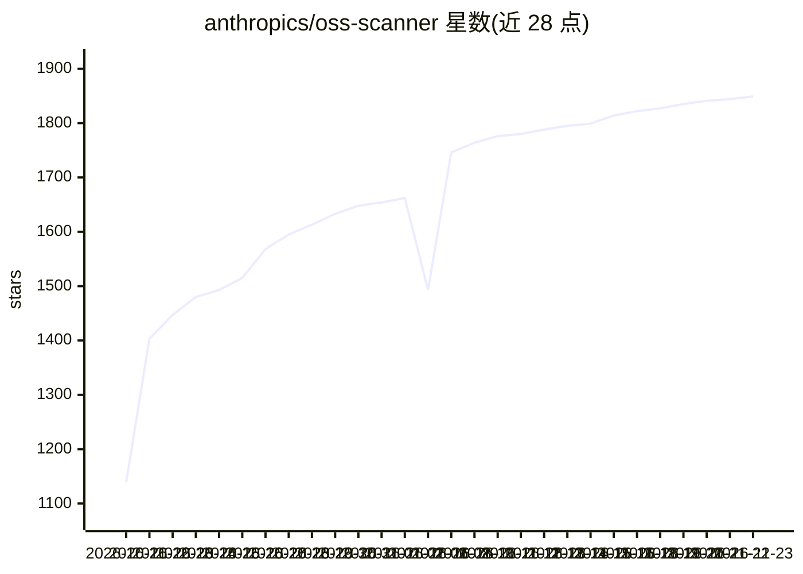

# anthropics/oss-scanner

⭐ 1,849 · Dockerfile · Apache-2.0 · 推送 2026-11-22 · [GitHub](https://github.com/anthropics/oss-scanner) · 组织维护

**开源项目维护者的 AI 安全漏洞扫描服务接入目录**

Anthropic 运营的服务：开源项目通过提交 PR 在 projects/<name> 目录登记，扫描器在隔离 VM 中构建项目，随后在无互联网环境中分析，将模型生成的漏洞报告（含复现步骤与建议补丁）发送给登记的联系邮箱。登记需提供 project.yaml 与 Dockerfile，可选提供威胁模型及报告/补丁格式指南。仓库本身不含扫描器，仅收录登记配置与本地预检工具（tools/validate.py、tools/check），且仅接受登记类 PR。

## 筛选速览

| 维度 | 判定 | 备注 |
|---|---|---|
| AI 角色 | `ai-native` | 本体是模型或模型工具 |
| 许可风险 | `permissive` | Apache-2.0 |
| 部署形态 | `self-host` | docker 或自建部署 |
| 模型依赖 | locked-api |  |
| 硬件要求 | — | 无带数字的原话,不猜 |
| 安装摩擦 | `low` | 无编译、无系统依赖或容器化 |
| 成熟度 | — | 结构信号不足 |

## 能力要点

- 通过 PR 登记项目，由 Anthropic 运营的扫描器自动分析
- 隔离 VM 构建后离线扫描，报告附复现步骤与建议补丁
- 支持 PGP 加密邮件与 GitHub 私密漏洞报告两种输出渠道
- 提供 tools/validate.py 与 tools/check 本地预检工具

## 适用场景

- 为我的开源项目登记自动安全扫描
- 配置漏洞报告的接收渠道与最低严重级别
- 本地预演扫描器构建流程以确认兼容

## 场景标签

`网络安全` · 领域:学习与行业

## 证据(README 行号)

> L3: OSS Scanner is a service by Anthropic to scan critical open-source repositories for security vulnerabilities. Learn 
> L15: Our security scanner builds your project in an isolated VM, then analyses it with no Internet access and emails wha
> L81: 2. We scan the project for vulnerabilities.

## 星数曲线

2026-10-21 1,139 → 2026-11-23 1,849（+710）

---
*卡片 v1 · prompt 1.4 · 生成 2026-11-23 · 置信度 mid · 依据 README sha `5bd37dd0c51a` · [字段定义](../../DATASET.md)*
