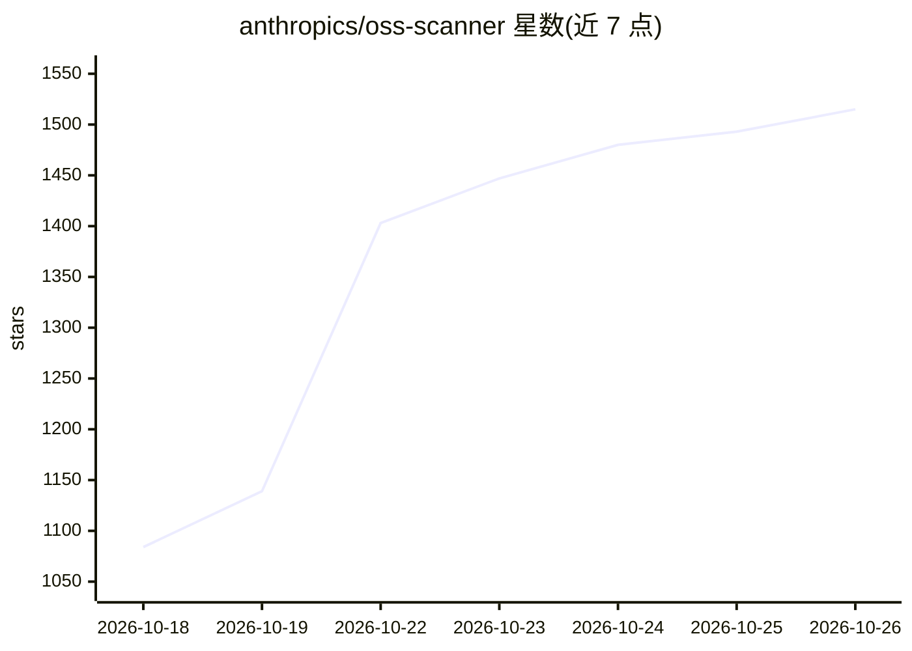

# anthropics/oss-scanner

⭐ 1,515 · Dockerfile · Apache-2.0 · 推送 2026-10-25 · [GitHub](https://github.com/anthropics/oss-scanner) · 组织维护

**开源仓库安全扫描服务的报名配置仓库（Anthropic 运营）**

该仓库是 Anthropic OSS Scanner 服务的项目登记处：开源项目通过 PR 添加 projects/<name> 目录、填写 project.yaml（仓库地址、联系人、可选 PGP 等）并提供 Dockerfile 即可报名。服务在隔离 VM 中构建项目，断网后扫描安全漏洞，将模型生成的报告（含复现步骤和建议补丁，不经过人工审查）邮件发给项目联系人；支持可选 threat_model.md 定制严重性评级口径。本地仅提供 validate 与 check 两个校验工具，需主机装有 git、Docker、Python 3 与 PyYAML。

## 筛选速览

| 维度 | 判定 | 备注 |
|---|---|---|
| AI 角色 | `ai-native` | 本体是模型或模型工具 |
| 许可风险 | `permissive` | Apache-2.0 |
| 部署形态 | `self-host` | docker 或自建部署 |
| 模型依赖 | locked-api |  |
| 硬件要求 | — | 无带数字的原话,不猜 |
| 安装摩擦 | `low` | 无编译、无系统依赖或容器化 |
| 成熟度 | — | 结构信号不足 |

## 能力要点

- 通过 PR 提交 project.yaml 与 Dockerfile 登记开源项目
- 隔离 VM 内断网扫描，报告含复现步骤与建议补丁
- 报告由模型生成、不经人工审查，不设 90 天披露期
- 支持 OpenPGP 加密报告与 threat_model.md 定制评级标准

## 适用场景

- 开源维护者为自己的关键仓库登记安全扫描
- 提交前用 tools/check 本地验证项目能否被扫描器构建
- 通过威胁模型文档定制漏洞严重性评级口径

## 场景标签

`网络安全` · 领域:学习与行业

## 证据(README 行号)

> L3: OSS Scanner is a service by Anthropic to scan critical open-source repositories for security vulnerabilities. Learn 
> L15: Our security scanner builds your project in an isolated VM, then analyses it with no Internet access and emails wha
> L69: * `tools/check` installs Claude Code into the image it builds (as the scanner does). Claude Code is covered by its 

## 星数曲线

2026-10-18 1,084 → 2026-10-26 1,515（+431）

---
*卡片 v1 · prompt 1.4 · 生成 2026-10-21 · 置信度 mid · 依据 README sha `d77950ce37c5` · [字段定义](../../DATASET.md)*
