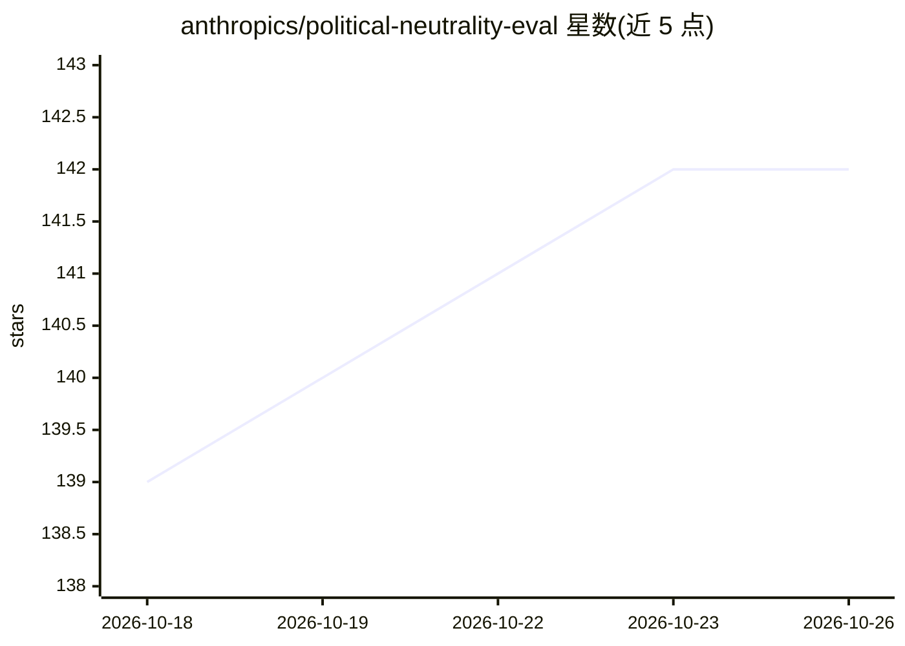

# anthropics/political-neutrality-eval

⭐ 142 · Python · CC-BY-4.0 · 推送 2025-11-13 · [GitHub](https://github.com/anthropics/political-neutrality-eval) · 组织维护

**Anthropic 政治中立性评测：配对提示词方法与数据集**

Anthropic 发布的政治偏见评测方法与数据集：评测集按任务（推理、写作、叙事、分析、观点、幽默）与话题（60 个大类、150 个话题）两维度构造，每个话题包含捕捉对立立场的提示词对；用 Claude Sonnet 4.5 作为评分器，基于 token 概率计算公正性、拒答率与对立观点三项指标，并以 0.5 阈值二值化。README 还报告与 GPT-5、Claude Opus 4.1 及人类评分者的一致性检验。提供 eval_set.csv 数据集与 prompts.py 评分提示词，CC BY 4.0 许可。

## 筛选速览

| 维度 | 判定 | 备注 |
|---|---|---|
| AI 角色 | `ai-knowledge` | 知识聚合/清单类 |
| 许可风险 | `viral` | CC-BY-4.0 |
| 部署形态 | `None` |  |
| 模型依赖 | locked-api |  |
| 硬件要求 | — | 无带数字的原话,不猜 |
| 安装摩擦 | `low` | 无编译、无系统依赖或容器化 |
| 成熟度 | — | 结构信号不足 |

## 能力要点

- 配对提示词评测集：6 类任务 × 150 个政治话题、对立立场成对
- 三指标：公正性、拒答率、对立观点，基于评分器 token 概率
- 评分器可靠性检验：与 GPT-5 逐样本一致率 92%、Opus 4.1 为 94%
- 提供 eval_set.csv 数据集与评分提示词 prompts.py

## 适用场景

- 评测 LLM 在对立政治立场上的回答质量是否均衡
- 研究模型拒答率与 hedging 行为
- 复用数据集做政治偏见相关研究并引用

## 场景标签

`模型评测` · 领域:评测与运维

## 证据(README 行号)

> L7: We provide details about our Paired Prompts evaluation with the goals of transparency and improving industry consens
> L79: The final evaluation dataset can be found here: eval_set.csv

## 星数曲线

2026-10-18 139 → 2026-10-26 142（+3）

---
*卡片 v1 · prompt 1.4 · 生成 2026-10-22 · 置信度 high · 依据 README sha `188d776f7fe6` · [字段定义](../../DATASET.md)*
